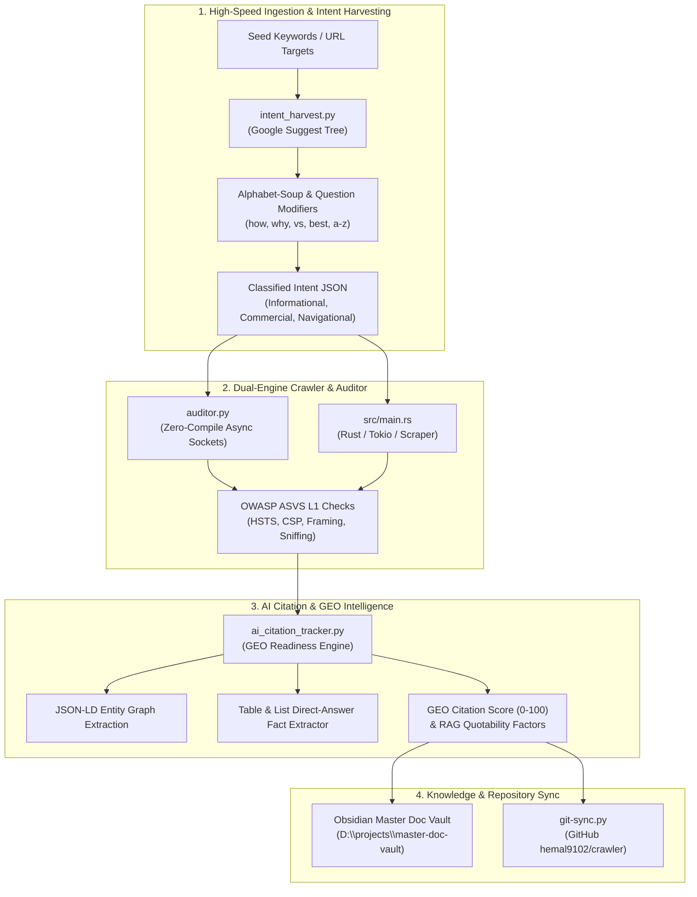

# 🕷️ Domain 6: AI Search, Crawling & Intent Intelligence Architecture
**High-Throughput Web Spidering, Google Autocomplete Mining & Generative Engine Optimization (GEO)**

> **System Path:** `D:\projects\crawler\`  
> **GitHub Remote:** `https://github.com/hemal9102/crawler` (Private)  
> **Tags:** `#project/crawler` `#domain/ai-search` `#systems/networking` `#geo/aio`

---

## 🗺️ Map of Content (MOC)

* [[06-AI-Search-and-Crawler-Engine/01 - Google Autocomplete & Real-Time Intent Harvesting Engine|01 - Google Autocomplete & Real-Time Intent Harvesting Engine]]
* [[06-AI-Search-and-Crawler-Engine/02 - AIO, GEO & SGE Citation Capture Mechanics|02 - AIO, GEO & SGE Citation Capture Mechanics]]
* [[06-AI-Search-and-Crawler-Engine/03 - Edge Interception of AI Bots & Crawlers|03 - Edge Interception of AI Bots & Crawlers]]
* [[06-AI-Search-and-Crawler-Engine/04 - The Economic Reality of SEO and The Generative Search Shift|04 - The Economic Reality of SEO & The Generative Search Shift]]
* [[06-AI-Search-and-Crawler-Engine/05 - Competitor Reverse-Engineering & Ranking Outflank Endpoints|05 - Competitor Reverse-Engineering & Ranking Outflank Endpoints]]
* [[06-AI-Search-and-Crawler-Engine/06 - MTA Deliverability, RFC Gateways & Mailbox Interrogation Endpoints|06 - MTA Deliverability, RFC Gateways & Mailbox Interrogation Endpoints]]
* [[06-AI-Search-and-Crawler-Engine/07 - Entity Resolution, Identity Graph & Cross-Platform Intelligence Endpoints|07 - Entity Resolution, Identity Graph & Cross-Platform Intelligence Endpoints]]
* [[06-AI-Search-and-Crawler-Engine/08 - Hidden Infrastructure Reconnaissance, Google Dorking & Wayback CDX Scraping|08 - Hidden Infrastructure Reconnaissance, Google Dorking & Wayback CDX Scraping]]
* [[06-AI-Search-and-Crawler-Engine/09 - The 48 Algorithmic Variables for Position 0, FAQ Schemas & AI Citation Dominance|09 - The 48 Algorithmic Variables for Position 0, FAQ Schemas & AI Citation Dominance]]
* [[06-AI-Search-and-Crawler-Engine/10 - German Tech Job Crawler & Non-LeetCode SRE Relocation Blueprint|10 - German Tech Job Crawler & Non-LeetCode SRE Relocation Blueprint]]
* [[06-AI-Search-and-Crawler-Engine/11 - Official German Corporate & Immigration Rules, Lebenslauf Standards & Relocation Playbook|11 - Official German Corporate & Immigration Rules, Lebenslauf Standards & Relocation Playbook]]
* [[06-AI-Search-and-Crawler-Engine/12 - High-Throughput Autonomous Ingestion & Contract-Driven Data Pipeline|12 - High-Throughput Autonomous Ingestion & Contract-Driven Data Pipeline]]

---

## 🏗️ System Overview & Component Pipeline

---

## ⚡ Connected Repositories & Execution Commands

| Component | Path | Execution Command | Output |
| :--- | :--- | :--- | :--- |
| **Intent Harvester** | `intent_harvest.py` | `python intent_harvest.py "keyword" --depth full` | Structured Intent JSON |
| **Citation Auditor** | `ai_citation_tracker.py` | `python ai_citation_tracker.py https://target.com` | GEO Citation Score & Factors |
| **ASVS / SEO Auditor** | `auditor.py` | `python auditor.py https://target.com` | Pydantic ASVS L1 Audit Report |
| **Rust Fast Engine** | `src/main.rs` | `cargo run -- https://target.com` | Native Compiled Audit Output |
| **Auto-Sync Engine** | `D:\projects\git-sync.py` | `python D:\projects\git-sync.py "D:\projects\crawler"` | Auto-commit & push to GitHub |

---
**Backlinks:**
* [[00 - Master Knowledge Graph Index|Master Knowledge Graph Index]]
* [[TOP_1_PERCENT_ENGINEERING_MONETIZATION_PLAYBOOK|Top 1% Engineering Playbook]]
