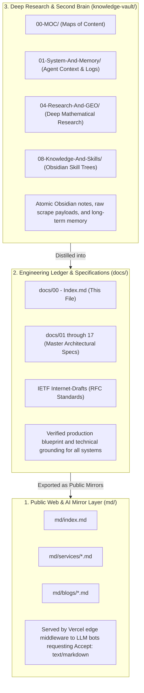

# 🏛️ TENSIX Master Architecture Graph & Engineering Ledger

> **Repository:** `D:\projects\HK\tensix`  
> **Target Production URL:** `https://www.tensix.in`  
> **Tags:** `#tensix` `#systems-architecture` `#geo` `#mta-infrastructure` `#ietf-rfc` `#knowledge-vault`

---

## 🗺️ Master Specification Index (MOC)

The 14 canonical engineering ledgers below represent the verified technical truth of TENSIX's infrastructure, algorithms, and market outflank:

### Track 1: Search Ingestion, Intent & AI Citation (GEO / SGE / AEO)
* [[01 - Google Autocomplete & Real-Time Intent Harvesting Engine.md|01 - Google Autocomplete & Real-Time Intent Harvesting Engine]]
* [[03 - Edge Interception of AI Bots & Crawlers.md|03 - Edge Interception of AI Bots & Crawlers]]
* [[04 - The Economic Reality of SEO and The Generative Search Shift.md|04 - The Economic Reality of SEO & The Generative Search Shift]]
* [[05 - Competitor Reverse-Engineering & Ranking Outflank Endpoints.md|05 - Competitor Reverse-Engineering & Ranking Outflank Endpoints]] *(Consolidated with Doc 15 Empirical Battle Plan)*
* [[07 - Entity Resolution, Identity Graph & Cross-Platform Intelligence Endpoints.md|07 - Entity Resolution, Identity Graph & Cross-Platform Intelligence Endpoints]]
* [[08 - Hidden Infrastructure Reconnaissance, Google Dorking & Wayback CDX Scraping.md|08 - Hidden Infrastructure Reconnaissance, Google Dorking & Wayback CDX Scraping]]
* [[09 - The 48 Algorithmic Variables for Position 0, FAQ Schemas & AI Citation Dominance.md|09 - The 48 Algorithmic Variables for Position 0, FAQ Schemas & AI Citation Dominance]] *(Consolidated with Doc 02 RAG Citation Mechanics)*
* [[17 - RFC Master Protocol Architecture for Web Crawlers, AI Citations & Diagnostic Engines.md|17 - RFC Master Protocol Architecture for Web Crawlers, AI Citations & Diagnostic Engines]]

### Track 2: Bare-Metal MTA, Mailbox Deliverability & Protocol Standards
* [[06 - MTA Deliverability, RFC Gateways & Mailbox Interrogation Endpoints.md|06 - Enterprise MTA Deliverability, RFC Gateways & Ingestion Architecture]] *(Consolidated with Doc 18 12-Level Deliverability)*
* [[16 - Internet Systems Stack, Email Infra & IT-Services Economics (Fact-Verified).md|16 - Internet Systems Stack, Email Infra & IT-Services Economics]]
* [[RFC-SUBMISSION-STEPS.md|IETF RFC Submission & Publishing Blueprint]]
* [[draft-shah-agent-readiness-evaluation-00.txt|IETF Internet-Draft: draft-shah-agent-readiness-evaluation-00]]
* [[draft-shah-agent-readiness-evaluation-01.txt|IETF Internet-Draft: draft-shah-agent-readiness-evaluation-01]]

### Track 3: High-Throughput Ingestion, DSA & Production Operations
* [[10 - German Tech Job Crawler & Non-LeetCode SRE Relocation Blueprint.md|10 - SRE Engineering Relocation, Crawler & Corporate Playbook]] *(Consolidated with Doc 11 German Statutory Rules)*
* [[12 - High-Throughput Autonomous Ingestion & Contract-Driven Data Pipeline.md|12 - High-Throughput Autonomous Ingestion & Contract-Driven Data Pipeline]]
* [[13 - Kernel-Level DSA & Mechanical Sympathy Rules.md|13 - Kernel-Level DSA & Mechanical Sympathy Rules]]
* [[14 - Production Engineering Ledger Local Dev & Cloud VPS Settings.md|14 - Production Engineering Ledger: Local Dev & Cloud VPS Settings]]
* [[EMPIRICAL-OBSERVATIONS.md|Empirical Operations & Low-Level Production Ledger]]
* [[OUTREACH-AI-COMPANIES.md|Outreach Blueprint for AI Infrastructure Enterprises]]

---

## 🔗 Tri-Folder Interconnection Architecture

TENSIX operates as a 3-tier synchronized knowledge pipeline:

### Directory Cross-References:
1. **Public Edge Mirrors:** [`D:\projects\HK\tensix\md\`](file:///D:/projects/HK/tensix/md)
   - `/md/index.md` $\leftrightarrow$ `docs/00 - Index.md`
   - `/md/services/email-deliverability.md` $\leftrightarrow$ `docs/06 - MTA Deliverability`
   - `/md/services/geo-aeo-seo.md` $\leftrightarrow$ `docs/09 - 48 Algorithmic Variables`
2. **Deep Obsidian Vault:** [`D:\projects\HK\tensix\knowledge-vault\`](file:///D:/projects/HK/tensix/knowledge-vault)
   - `knowledge-vault/00-MOC/` maintains global graph linkages across all sub-disciplines.
   - `knowledge-vault/04-Research-And-GEO/` houses competitor snapshots and crawler telemetry.
   - `knowledge-vault/08-Knowledge-And-Skills/` maintains master skills trees.

---

## 🛠️ Core Tooling & Verification Pipeline

| Tool | Path | Purpose | Execution |
| :--- | :--- | :--- | :--- |
| **Geo-Kernel** | `tools/geo-kernel/` | S2 L16/L12 cell math & NAP entity verification | `cargo run --manifest-path tools/geo-kernel/Cargo.toml -- audit . 23.0366 72.5615` |
| **Real-Time Push Gateway** | `push_indexing_gateway.py` | IndexNow (Bing/Yandex/Naver) & Google Indexing | `python push_indexing_gateway.py --all-services --execute` |
| **Competitor Recon** | `competitor_outflank.py` | Google Suggest & competitor sitemap analyzer | `python competitor_outflank.py --limit-pages 40` |
| **GitHub Auto-Sync** | `D:\projects\git-sync.py` | Synchronizes repo with GitHub releases | `python D:\projects\git-sync.py "D:\projects\HK\tensix"` |

---

**Backlinks:**
* [[knowledge-vault/00-MOC/00-MASTER-MOC.md|Obsidian Master MOC]]
* [[md/index.md|Public Markdown Twin (Homepage)]]
