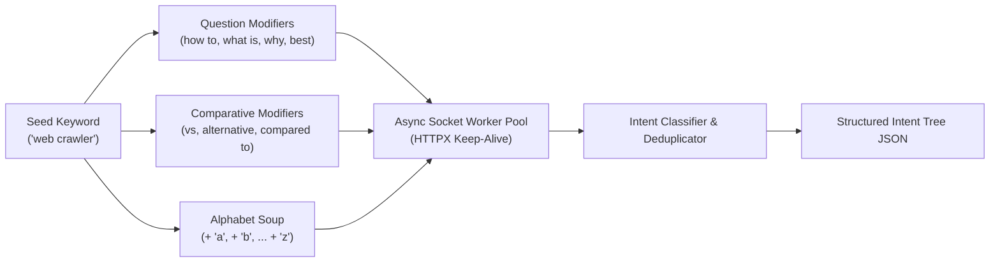

# 01 - Google Autocomplete & Real-Time Intent Harvesting Engine

> **Document ID:** `CRAWLER-01`  
> **Source Script:** `D:\projects\crawler\intent_harvest.py`  
> **Tags:** `#intent-mining` `#google-suggest` `#reverse-engineering` `#seo`

---

## 🎯 Executive Summary

Before users click on SERP results, their search journeys begin in the search input box. Google Autocomplete is not a static list; it is a **real-time Bayesian predictor** reflecting the exact search velocity, query patterns, and intent clusters of millions of searchers worldwide.

By querying the public completion endpoint asynchronously, this engine maps out the **entire semantic query tree** for any niche in seconds.

---

## 🔬 Protocol & Endpoint Anatomy

```http
GET https://suggestqueries.google.com/complete/search?client=chrome&hl=en&gl=us&q={query_stem} HTTP/1.1
Host: suggestqueries.google.com
User-Agent: Mozilla/5.0 (Windows NT 10.0; Win64; x64) AppleWebKit/537.36 ...
Accept: application/json
```

### JSON Response Schema
```json
[
  "web crawler rust",
  [
    "web crawler rust github",
    "web crawler rust tutorial",
    "best web crawler rust",
    "spider web crawler rust"
  ],
  [],
  [],
  {
    "google:suggestrelevance": [1250, 1200, 1150, 1100],
    "google:suggesttype": ["QUERY", "QUERY", "QUERY", "QUERY"]
  }
]
```

* `Index 0`: The echo of the query stem.
* `Index 1`: Array of top suggested completions sorted by dynamic search volume.
* `Index 4.google:suggestrelevance`: Internal relevance scoring weights computed by Google's RankBrain and user query history.

---

## 🌪️ Intent Permutation Strategy: The Alphabet-Soup Matrix

A single keyword only returns 5–10 suggestions. To capture hundreds of latent search intents, the engine applies combinatorial permutation:



### Intent Classification Rules
1. **Informational (Question):** Contains `how to`, `what is`, `why does`, `can`, `tutorial`.
2. **Comparative / Research:** Contains ` vs `, `alternative to`, `or`, `compared to`.
3. **Commercial / Investigation:** Contains `best`, `pricing`, `tools`, `review`, `library`, `open source`.
4. **Navigational / Broad:** Generic brand or keyword completions.

---

## ⚙️ Concurrency & Socket Performance

* **Connection Pool:** Uses `httpx.Limits(max_keepalive_connections=20, max_connections=50)` over raw HTTP/2 and TCP keep-alive.
* **Polite Chunking:** Batches requests in chunks of 15 with a 50ms interval, enabling ~300 requests per minute without triggering HTTP 429 rate limits or IP challenges.
* **Zero External Dependencies:** Built on standard Python async runtime without requiring browser automation or Selenium.

---
**Backlinks:**
* [[06-AI-Search-and-Crawler-Engine/00 - Index|Domain Index]]
* [[06-AI-Search-and-Crawler-Engine/02 - AIO, GEO & SGE Citation Capture Mechanics|02 - AIO & GEO Citation Mechanics]]
