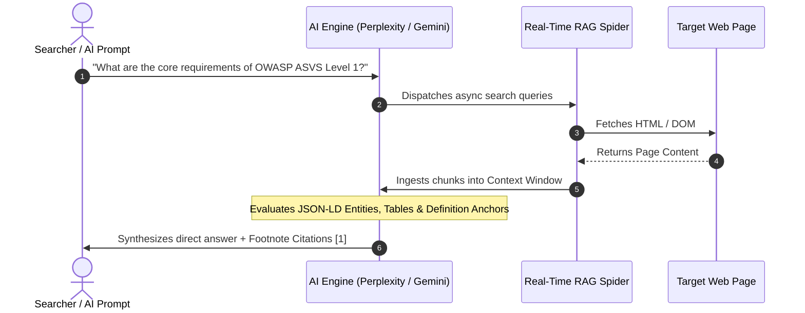

# 02 - AIO, GEO & SGE Citation Capture Mechanics

> **Document ID:** `CRAWLER-02`  
> **Source Script:** `D:\projects\crawler\ai_citation_tracker.py`  
> **Tags:** `#geo` `#aio` `#sge` `#rag-optimization` `#citations`

---

## 🎯 Executive Summary

In traditional SEO, the goal was to rank #1 on the blue links. In **Generative Engine Optimization (GEO)** and **AI Overviews (AIO)**, the goal is to be **cited by the LLM as the authoritative source** during real-time Retrieval-Augmented Generation (RAG).

AI models (Perplexity, Google Gemini, OpenAI Search) do not cite pages based on backlink counts alone. They evaluate **information density, extractability, structured tables, and JSON-LD entity graphs**.

---

## 🔬 How LLMs Select Sources for RAG Citations

### The 4 Pillars of Winning AI Citations

| Pillar | Mechanism | Why LLMs Prioritize It |
| :--- | :--- | :--- |
| **1. JSON-LD Graph** | `@type: TechArticle`, `FAQPage`, `HowTo` | LLMs don't have to guess relationships; entities are strictly defined in machine-readable JSON. |
| **2. HTML Tables (`<table>`)** | Markdown / HTML tabular data | Tables provide structured, zero-ambiguity comparisons that fit neatly into token matrices. |
| **3. Concise Definition Anchors** | 40-word lead paragraph ("X is a...") | AI Overviews pick the cleanest declarative sentence for direct zero-shot summary cards. |
| **4. Numbered / Bullet Lists** | `<ol>`, `<ul>` steps | LLMs format synthesis answers as lists; matching source structure ensures direct quotation. |

---

## 📊 The GEO Citation Readiness Formula

The `ai_citation_tracker.py` script scores target pages on a deterministic **0 to 100 scale**:

$$\text{GEO Score} = \text{JSON-LD Points (30)} + \text{Tables (20)} + \text{Definition Anchors (20)} + \text{Structured Lists (15)} + \text{Meta Clarity (15)}$$

* **Score $\ge 70$:** Highly primed for inclusion in Google SGE / Perplexity / ChatGPT Search footnote citations.
* **Score $< 50$:** Trapped behind unstructured prose; LLMs will skip the page in favor of cleaner structured competitors.

---

## 🛠️ Actionable Recommendations for Winning AI Citations

1. **Place Definition Immediately Below H1:**
   > `
<strong>[Entity Name]</strong> is a [Category] designed to [Primary Function] by [Mechanism].
`
2. **Convert Feature Paragraphs into HTML Tables:**
   * Replace descriptive text with multi-column tables detailing attributes, limits, and compatibility.
3. **Embed Rich Nested JSON-LD:**
   * Always include `mainEntity`, `about`, and `mentions` linking out to authoritative Wikidata / Schema.org nodes.

---
**Backlinks:**
* [[06-AI-Search-and-Crawler-Engine/00 - Index|Domain Index]]
* [[06-AI-Search-and-Crawler-Engine/03 - Edge Interception of AI Bots & Crawlers|03 - Edge Interception of AI Bots]]
