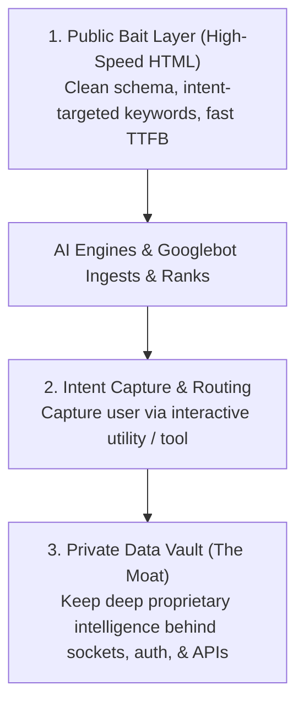

# 04 - The Economic Reality of SEO & The Generative Search Shift

> **Document ID:** `CRAWLER-04`  
> **Tags:** `#seo-economics` `#geo` `#algorithmic-incentives` `#model-collapse` `#reverse-api`

---

## 🎯 1. The Core Thesis: SEO as Google’s Unpaid Data Cleaning Workforce

The entire global SEO industry did not emerge because search engines were brilliant; it emerged because **Googlebot was fundamentally blind, compute-constrained, and prone to hallucinating trash rankings.**

In the early web (late 1990s through 2010s), raw web crawlers suffered from severe architectural limitations:
* They could not parse JavaScript execution cleanly without massive data center server overhead.
* They could not infer semantic hierarchy from plain text.
* They could not distinguish authoritative factual claims from spammy keyword stuffing.

### The Economic Masterstroke: Outsourcing Data Curation
If Google had hired human data annotators and engineers to structure, categorize, and clean the world's billions of web pages, it would have cost **hundreds of billions of dollars in annual payroll**.

Instead, Google created an algorithmic incentive structure:
> *"If you want organic search traffic and billions of dollars in commercial revenue, **YOU** must clean your data for our bot. **YOU** must tag your headings (`<h1>`), write your summaries (`<meta description>`), format your canonical URLs, build XML sitemaps, and structure your entities in JSON-LD."*

An entire global industry of developers, content creators, and SEOs became **Google’s free, crowdsourced data engineering department**.

---

## 🔬 2. History Repeating Itself: The Shift from SEO to GEO

Just as early search engines needed humans to spoon-feed them structured HTML, **modern Large Language Models (LLMs) and RAG engines are suffering from the exact same blindness**:

```
Traditional Googlebot (2000s)     ──►  Hallucinated bad links & spam
                                        └── Solution: Forced webmasters to write Schema & clean HTML (SEO)

Modern LLM / RAG Spiders (2020s)  ──►  Hallucinates facts & bad citations
                                        └── Solution: Forcing webmasters to write tables & entity graphs (GEO)
```

Today, engineers optimize for **Generative Engine Optimization (GEO)** by building crisp definition sentences, Markdown tables, and Schema.org graphs specifically so that PerplexityBot, GPTBot, and Google AIO don't hallucinate when synthesizing answers.

---

## 🌪️ 3. The New Counter-Intuitive POV: The "Zero-Click Parasite Trap" & The Reverse API Economy

### A. The Broken Social Contract
For 25 years, the open web functioned on a clear quid pro quo:
1. **Webmasters provided:** Clean, free, high-effort content and infrastructure compute.
2. **Search engines provided:** Human visitors via outbound blue-link clicks.

**AIO (AI Overviews) and Generative Search break this social contract entirely.** 
The AI crawler consumes your bandwidth, reads your tables, synthesizes your hard-earned research directly into the chat interface, and **sends zero clicks back to the source**. The publisher provides all the compute and data, while the AI platform captures 100% of the monetization and user attention.

### B. The Reverse API Paradox
For decades, software engineers built:
* **APIs (JSON/gRPC)** for machines.
* **HTML/CSS** for humans.

Today, web development has devolved into a bizarre **Reverse API Paradox**:
* Developers are forced to write machine-readable Markdown, Schema graphs, and structured tables **inside** human-facing HTML pages.
* Why? Because AI platforms refuse to pay for paid API endpoints. Instead, they deploy headless web crawlers to scrape public HTML and extract free data under the guise of "fair use search indexing."

### C. The Inevitable Threat: "Model Collapse" & The Synthetic Sludge Spiral
If AI search engines continue to consume content without sending traffic or revenue back to creators:
1. **High-effort human creators will stop publishing open, structured data.**
2. The open web will be filled with cheap, auto-generated AI scrapers regurgitating previously scraped AI content.
3. Future LLMs and RAG crawlers will ingest **synthetic data written by other AI bots**.
4. This triggers **Model Collapse (Algorithmic Inbreeding)**: the models lose tail distributions, amplify hallucinations, and degrade in factual accuracy.

---

## 🛡️ 4. The Top 1% Engineering Counter-Strategy

Given this reality, systems engineers should not play the traditional SEO game of building massive encyclopedias for free AI harvesting. The modern playbook consists of three rules:



1. **Use Programmatic SEO Exclusively as a Distribution Funnel:**
   * Never put your core proprietary data or deep intelligence in plain, unmonetized public text.
   * Use automated intent-mined pages (via `intent_harvest.py`) purely as top-of-funnel lead capture.
2. **Put True Data Depth Behind Protocol & Auth Walls:**
   * Real value must live behind authenticated sessions, WebSocket feeds, private databases, or direct API keys that automated AI crawlers cannot scrape without authorization.
3. **Exploit the Long-Tail Speed Advantage:**
   * Big corporate sites move slowly and take months to clean their data.
   * High-speed programmatic pipelines can detect emerging search intent in minutes, deploy lightweight ASVS-compliant edge pages, and capture high-intent users before the search monopolies can synthesize them away.

---
**Backlinks:**
* [[06-AI-Search-and-Crawler-Engine/00 - Index|Master Domain Index]]
* [[06-AI-Search-and-Crawler-Engine/02 - AIO, GEO & SGE Citation Capture Mechanics|02 - AIO & GEO Mechanics]]
