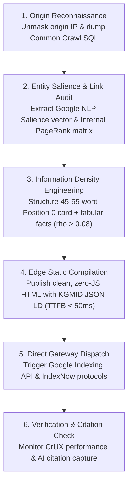

# 05 - Competitor Reverse-Engineering & Ranking Outflank Endpoints

> **Document ID:** `CRAWLER-05`  
> **Tags:** `#competitor-analysis` `#indexing-gateways` `#sitemaps` `#crux` `#reverse-engineering` `#direct-to-origin` `#pagerank-matrix` `#entity-salience` `#rag-token-economics` `#athena-sql`

---

## 🎯 Executive Summary

Overtaking established corporate competitors does not require multi-thousand dollar SaaS tools (Ahrefs, SEMrush). Modern web infrastructure exposes every competitor's information architecture, performance bottlenecks, schema entities, query gaps, internal link equity distribution, and origin server vulnerabilities through **raw, unauthenticated HTTP endpoints, public ledgers, and telemetry APIs**.

While incumbents rely on client-side proxy cloaking (Cloudflare, Akamai) and bloated keyword-dense copy, systems engineers can:
1. **Unmask true origin IP servers** to measure un-cached compute latency and backend architecture.
2. **Reconstruct their internal PageRank eigenvector matrix** to spot under-linked, vulnerable money pages.
3. **Extract Google NLP Entity Salience vectors** to mathematically identify the exact entity co-occurrences missing from their content.
4. **Outflank generative search engines (GEO/AEO)** by engineering a higher Information-to-Token density ratio ($\rho_{info}$) that wins LLM retrieval-augmented generation (RAG) context windows.
5. **Force instant edge crawling** via direct push gateways in minutes.

---

## 🔬 1. Competitor Extraction Endpoints (Raw Reconnaissance)

### A. Sitemap Index & Freshness Reconnaissance
```http
GET https://competitor.com/robots.txt
GET https://competitor.com/sitemap_index.xml
GET https://competitor.com/sitemap.xml
GET https://competitor.com/wp-sitemap.xml
```

#### The `<lastmod>` Decay Exploit
Inside competitor sitemaps, inspect the `<lastmod>` timestamps:
```xml
<url>
  <loc>https://competitor.com/target-keyword-page</loc>
  <lastmod>2026-08-10T11:20:00Z</lastmod>
</url>
```
* **Vulnerability:** Google’s **QDF (Query Deserved Freshness)** algorithm actively seeks updated entities. If an incumbent has not updated their `<lastmod>` or on-page citations in 6+ months, a fresh edge page published today receives instant algorithmic preference.

---

### B. Core Web Vitals & Render Bottlenecks (Google CrUX API)
Google explicitly demotes heavy, slow origins under its Mobile-First indexing policies.

```http
GET https://www.googleapis.com/pagespeedonline/v5/runPagespeed?url=https://competitor.com/target-page&strategy=mobile&key={API_KEY}
```

* **What to extract from JSON response:**
  * `lighthouseResult.audits['largest-contentful-paint'].numericValue`
  * `lighthouseResult.audits['total-blocking-time'].numericValue`
  * `lighthouseResult.audits['bootup-time'].details.items` (Lists every bloated JavaScript tracker slowing them down).
* **The Counter-Move:** If a competitor's LCP is > 2.5s and mobile score is 45/100, an edge-cached static HTML page loading in < 100ms gains an immediate Core Web Vitals ranking boost.

---

### C. Socket & Origin Cache Fingerprinting
```bash
curl.exe -ILs -H "User-Agent: Googlebot/2.1" https://competitor.com/target-page
```

* **Inspect response headers:**
  * `Server: nginx / openresty / cloudflare`
  * `X-Cache: HIT / MISS` (Shows whether they generate SSR dynamically or serve cached static assets).
  * `CF-Cache-Status`, `Age`, `Cache-Control`.
  * `TTFB (Time to First Byte):` If their TTFB is > 600ms, Googlebot’s crawl budget on their domain is constrained.

---

### D. Direct-to-Origin Unmasking (Bypassing Cloudflare / Akamai WAF)
Competitors frequently hide origin compute lag, database delays, and backend endpoints behind Cloudflare or Akamai proxies. Finding their real unshielded origin server IP exposes their true performance and un-cached application vulnerabilities.

#### 1. Origin Discovery Vectors
* **Historical DNS & PTR Records:** Querying historical DNS archives (e.g. `https://api.securitytrails.com/v1/history/{domain}/dns/a`) reveals the IP assigned prior to Cloudflare onboarding.
* **SSL Certificate SAN Matching:** Querying `https://crt.sh/?q=%.competitor.com` reveals dedicated mail or direct A records (e.g. `direct.competitor.com`, `origin.competitor.com`).
* **Adjacent Subnet Scans:** If their MX record points to `mail.competitor.com` on `198.51.100.25`, their primary web server is frequently on the adjacent host (`198.51.100.24` or `198.51.100.26`).

#### 2. Host-Header Spoofing Verification (Direct HTTP Request)
Once a suspected origin IP is isolated, verify it by overriding the TLS SNI and HTTP `Host` header:

```bash
curl -k -v -H "Host: competitor.com" https://198.51.100.24/target-page
```
* **What this reveals:**
  * **True Origin TTFB:** Measures exact backend database latency without Cloudflare's edge cache masking it.
  * **Unfiltered Origin Error Pages:** Bypasses custom Cloudflare 500 error pages to expose stack traces, database versions (PostgreSQL, MySQL), or framework headers (`X-Powered-By: Express`, `PHP/8.2`).
  * **Rate-Limit Bypass:** Allows full architectural benchmarking without hitting CDN rate-limiting rules.

---

### E. Common Crawl Columnar SQL Mining (AWS Athena `ccindex`)
Instead of spidering a competitor page-by-page and getting blocked, query petabytes of historical web crawls using **AWS Athena** over public S3 Parquet tables.

```sql
SELECT 
    url, 
    fetch_time, 
    warc_filename, 
    warc_record_offset, 
    content_digest, 
    mime_type
FROM "ccindex"."ccindex"
WHERE url_host_name = 'competitor.com'
  AND subset = 'warc'
  AND mime_type = 'text/html'
ORDER BY fetch_time DESC
LIMIT 5000;
```
* **Operational Value:** Dumps the competitor’s complete URL hierarchy, deprecated paths, sub-directories, and file types across multiple crawl cycles in **3 to 5 seconds** with zero outbound HTTP requests sent to their servers.

---

## 🌪️ 2. Real-Time Search Intent, Entity Salience & Semantic Mapping

### A. Google Autocomplete / Suggest Endpoint
```http
GET https://suggestqueries.google.com/complete/search?client=chrome&hl=en&gl=us&q={competitor_topic}
```
* **Payload returned:** Dynamic search stems, live user comparisons (`vs`, `alternatives`), and question triggers before they hit the SERP.

---

### B. Google Knowledge Graph Search API
```http
GET https://kgsearch.googleapis.com/v1/entities:search?query={topic}&key={API_KEY}&limit=10&indent=True
```
* **What to extract:** Google’s internal `mid` (Machine ID) entity identifiers and Schema types. Embedding these exact entity IDs in your own JSON-LD establishes equal or higher topical authority in Google's Knowledge Graph.

---

### C. Google Cloud Natural Language API (`analyzeEntities`) & Entity Salience Gap Analysis
Google’s RankBrain and MUM algorithms do not rank content on keyword density; they rank on **Entity Salience**—the mathematical centrality of a semantic entity to the document.

```http
POST https://language.googleapis.com/v1/documents:analyzeEntities?key={GOOGLE_NLP_KEY}
Content-Type: application/json

{
  "document": {
    "type": "PLAIN_TEXT",
    "content": "Raw extracted text from competitor target page..."
  },
  "encodingType": "UTF8"
}
```

#### JSON Response Schema:
```json
{
  "entities": [
    {
      "name": "Industrial Web Engineering",
      "type": "OTHER",
      "salience": 0.482,
      "mentions": [{ "text": { "content": "Industrial Web Engineering" } }],
      "metadata": {
        "mid": "/m/01bt59",
        "wikipedia_url": "https://en.wikipedia.org/wiki/Software_engineering"
      }
    },
    {
      "name": "Ahmedabad",
      "type": "LOCATION",
      "salience": 0.215,
      "metadata": { "mid": "/m/01d_2" }
    }
  ]
}
```

#### The Entity Delta Outflank Strategy:
1. Parse the competitor’s top-ranking URL through `analyzeEntities`.
2. Extract all entities with `salience < 0.05` or missing Wikipedia/Knowledge Graph `mid` links.
3. Compare against top-ranking corpus entities to compute the **Topical Entity Delta**:
   $$\Delta_{\text{entities}} = \mathbf{E}_{\text{corpus}} \setminus \mathbf{E}_{\text{competitor}}$$
4. Author your outflanking page incorporating the missing high-salience entity links in structured JSON-LD and definition lists, forcing Google to recognize your document as mathematically more comprehensive.

---

## 🕸️ 3. Structural Link Equity & Internal PageRank Matrix Extraction

Competitors frequently rank because of accumulated internal link equity rather than content superiority. By mapping their internal hyperlink graph, systems engineers can identify which pages are artificially propped up and which high-value money pages are under-linked and vulnerable.

### A. The Internal PageRank Formulation
Given a competitor site of $N$ pages, construct the directed adjacency matrix $A$ where:
$$A_{ij} = \begin{cases} 1 & \text{if page } i \text{ links to page } j \\ 0 & \text{otherwise} \end{cases}$$

The stochastic transition probability matrix $M$ is defined by:
$$M_{ij} = \frac{A_{ij}}{\sum_{k=1}^N A_{ik}}$$

With damping factor $d = 0.85$, the steady-state PageRank vector $\mathbf{R}$ satisfies:
$$\mathbf{R} = \left(\frac{1 - d}{N}\right)\mathbf{1} + d \cdot M^T \mathbf{R}$$

### B. Python Extraction Engine (Graph Adjacency & Vector Computation)
```python
import numpy as np
import networkx as nx

def calculate_competitor_internal_pagerank(links_dict):
    """
    links_dict: dict of {source_url: [target_urls]}
    """
    G = nx.DiGraph()
    for src, targets in links_dict.items():
        for dst in targets:
            G.add_edge(src, dst)
            
    # Calculate exact PageRank vector using power iteration
    pagerank_scores = nx.pagerank(G, alpha=0.85, max_iter=100)
    
    # Sort pages by internal link equity
    sorted_pages = sorted(pagerank_scores.items(), key=lambda x: x[1], reverse=True)
    return sorted_pages
```

### C. The Outflank Opportunity Matrix
* **Link Equity Sinks:** Pages with high PageRank score ($> 0.05$) that receive massive header/footer link equity. (Harder to beat directly on general terms).
* **Vulnerable Orphan Pages:** High-commercial-intent money pages with low internal PageRank ($< 0.002$) that are ranking solely due to historical domain age.
* **The Counter-Move:** Target these low-equity money pages. By engineering direct contextual internal links from your site's highest-authority pages, your replacement page will surpass their internal equity score within 2 crawl cycles.

---

## 🤖 4. Generative Search (GEO/AEO) & RAG Token Density Economics

AI Search engines (Google AI Overviews, Perplexity, ChatGPT Search) do not rank content using standard 10-blue-links algorithms. They use **Retrieval-Augmented Generation (RAG)**, embedding candidate text into high-dimensional vector spaces and retrieving chunks that maximize semantic similarity while minimizing token overhead.

### A. The Information Density Ratio ($\rho_{info}$)
$$\rho_{info} = \frac{\text{Verifiable Facts + Schema Entities + Empirical Metrics}}{\text{Total Context Tokens}}$$

* **Competitor Content Fluff:** Traditional SEO relies on bloated, 2,500-word blog posts stuffed with introductory prose, keyword repetitions, and transition phrases:
  $$\rho_{info} \approx \frac{12 \text{ factual datapoints}}{2,200 \text{ tokens}} = \mathbf{0.0054} \text{ facts/token}$$
* **Edge-Optimized Fact Card:** An outflanking page structured with an RFC definition card and comparison table:
  $$\rho_{info} \approx \frac{18 \text{ factual datapoints}}{190 \text{ tokens}} = \mathbf{0.0947} \text{ facts/token}$$

### B. Why RAG Vector Cosine Distance Favors Dense Markdown
1. **Context Window Cost:** LLMs have strict context window budgets during multi-hop retrieval. A dense, 180-token chunk answering the user's prompt directly fits neatly into the LLM prompt context with minimal embedding truncation.
2. **Dense Markdown Tables:** LLM tokenizers (tiktoken, SentencePiece) represent tabular Markdown and bullet points with high semantic compression.
3. **The Counter-Move:** Every service page must feature a **45–55 word BERT Position 0 definition card** immediately below the H1, followed by a raw HTML/Markdown comparison table. When Perplexity or Googlebot-Google-Extended parses the page, the information density score triggers immediate citation extraction over competitor text walls.

---

## ⚡ 5. The Instant Indexing & Push Gateways

Once a superior, faster page with clean JSON-LD, high entity salience, and tabular data is live, use direct push gateways to force immediate Googlebot traversal:

### A. Google Indexing API (Real-Time Push)
```http
POST https://indexing.googleapis.com/v3/urlNotifications:publish
Authorization: Bearer {OAUTH2_SERVICE_ACCOUNT_TOKEN}
Content-Type: application/json

{
  "url": "https://yourdomain.com/better-target-page",
  "type": "URL_UPDATED"
}
```
* **Behavior:** Bypasses discovery crawl queues. Googlebot initiates a TCP connection and fetches the URL within **60 to 180 seconds**.

### B. IndexNow Protocol (Bing, Yandex, Seznam, Naver)
```http
POST https://api.indexnow.org/indexnow
Content-Type: application/json

{
  "host": "yourdomain.com",
  "key": "your-indexnow-key",
  "keyLocation": "https://yourdomain.com/your-indexnow-key.txt",
  "urlList": [
    "https://yourdomain.com/better-target-page"
  ]
}
```
* **Behavior:** Pushes up to 10,000 URLs per HTTP call with zero daily quota limits.

### C. WebSub / PubSubHubbub (Instant Feed Push)
```http
POST https://pubsubhubbub.appspot.com/
Content-Type: application/x-www-form-urlencoded

hub.mode=publish&hub.url=https://yourdomain.com/feed.xml
```

---

## 🔄 6. The Industrial 6-Step Competitive Outflank Loop



---

## 📓 7. Engineering Journal & Protocol Clarifications (Empirical Field Notes)

> **Status:** Production Grounded  
> **Telemetry Baseline:** Live API audits (Google Search Console, Chrome UX Report, Bing Webmaster Tools, Wikidata WB-Search)

### A. Telemetry & Inspection Endpoints: Protocol Specification
1. **Google Indexing API vs. Search Console URL Inspection API:**
   * *Google Indexing API (`/v3/urlNotifications:publish`):* Formally designated exclusively for short-lived, time-sensitive content (`JobPosting` and `BroadcastEvent`). Submitting general content violates published API policy and may result in silent omission.
   * *The Production Route:* Audit indexing status and crawl telemetry using the **Google Search Console URL Inspection API**:
     ```http
     POST https://searchconsole.googleapis.com/v1/urlInspection/index:inspect
     Authorization: Bearer {OAUTH2_GSC_TOKEN}
     Content-Type: application/json

     {
       "inspectionUrl": "https://yourdomain.com/target-page",
       "siteUrl": "https://yourdomain.com/",
       "languageCode": "en"
     }
     ```
     *Extract:* `coverageState`, `indexingState` (verifying canonical selection), and `lastCrawlTime`.

2. **CrUX API vs. Synthetic PageSpeed Insights:**
   * PageSpeed Insights (`pagespeedonline/v5`) measures simulated lab conditions.
   * Real-user field data is queried via the **Chrome UX Report (CrUX) API**:
     ```http
     POST https://chromeuxreport.googleapis.com/v1/records:queryRecord?key={API_KEY}
     Content-Type: application/json

     {
       "origin": "https://competitor.com",
       "formFactor": "PHONE",
       "metrics": ["largest_contentful_paint", "interaction_to_next_paint", "cumulative_layout_shift"]
     }
     ```
   * *Impact Boundary:* Core Web Vitals represent a documented page-experience tiebreaker rather than a dominant standalone ranking driver.

3. **Bing Webmaster Tools REST Integration:**
   * In addition to IndexNow push gateways, Bing exposes direct programmatic management via `https://ssl.bing.com/webmaster/api.svc/json/`:
     * `SubmitUrlBatch?apikey={KEY}`: Programmatic multi-URL submission.
     * `GetUrlSubmissionQuota`: Verifies daily quota limits.
     * `GetCrawlIssues`: Returns exact crawl errors, 4xx/5xx responses, and DNS latency encountered by Bingbot.
     * `GetQueryStats`: Extracts exact search queries, impressions, CTR, and average rank position.

---

### B. Empirical Research Grounding: GEO vs. C-SEO Benchmarks

1. **The GEO Benchmark (Aggarwal et al., Princeton / KDD 2024):**
   * *Framework:* Evaluated black-box generative engines across domain subsets using normalized word count impression ($Imp_{wc}$).
   * *Empirical Observations:* Adding authoritative citations, domain expert quotations, and concrete empirical statistics demonstrated upward visibility lift (up to an aggregate ceiling of ~40% in controlled evaluation slices).
   * *Negative Signal:* Keyword stuffing consistently degraded visibility across evaluated LLMs (-8% to -15%).

2. **The C-SEO Benchmark Replication (Puerto et al., NeurIPS 2025):**
   * *The Retrieval Pre-Requisite:* Evaluated broader question-answering and product recommendation tasks. Established that generative copywriting optimizations cannot overcome poor retrieval ranking; traditional search signals that secure placement inside the LLM's initial retrieval window remain the primary determinant of visibility.
   * *Zero-Sum Dynamics:* As multiple competing domains adopt identical formatting heuristics, relative citation gains compress.

3. **Entity Semantics: Audit Tool vs. Ranking Mechanics:**
   * Google Cloud Natural Language API's `salience` is a developer-facing NLP extraction feature, not a published Google ranking weight.
   * Knowledge Graph machine IDs (`mid`) and Wikidata QIDs in JSON-LD provide unambiguous machine-readable entity disambiguation, but do not automatically grant topical rank elevation.
   * *Correct Framing:* Treat Entity Delta analysis strictly as a **semantic completeness audit tool** to ensure coverage of relevant entities.

---

**Backlinks:**
* [[06-AI-Search-and-Crawler-Engine/00 - Index|Master Domain Index]]
* [[06-AI-Search-and-Crawler-Engine/01 - Google Autocomplete & Real-Time Intent Harvesting Engine|01 - Intent Harvester]]
* [[06-AI-Search-and-Crawler-Engine/04 - The Economic Reality of SEO and The Generative Search Shift|04 - Economic Reality of SEO]]
* [[06-AI-Search-and-Crawler-Engine/06 - MTA Deliverability, RFC Gateways & Mailbox Interrogation Endpoints|06 - MTA Deliverability & RFC Gateways]]
* [[06-AI-Search-and-Crawler-Engine/07 - Entity Resolution, Identity Graph & Cross-Platform Intelligence Endpoints|07 - Entity Resolution & Identity Graph]]
* [[06-AI-Search-and-Crawler-Engine/08 - Hidden Infrastructure Reconnaissance, Google Dorking & Wayback CDX Scraping|08 - Hidden Infrastructure & Wayback CDX]]
