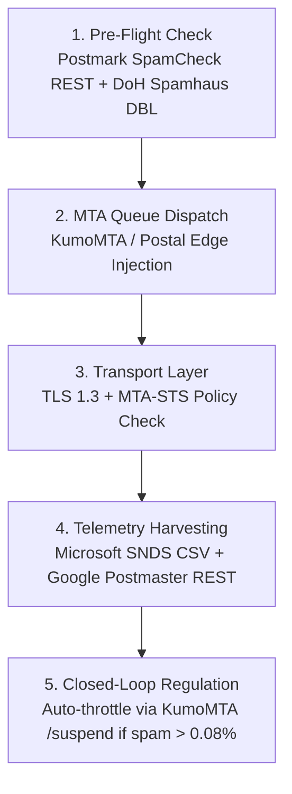

# 06 - MTA Deliverability, RFC Gateways & Mailbox Interrogation Endpoints

> **Document ID:** `CRAWLER-06`  
> **Tags:** `#mta-deliverability` `#rfc-gateways` `#mailbox-interrogation` `#postmaster-apis` `#spam-diagnostics` `#snds` `#kumomta` `#doh-dnsbl`

---

## 🎯 Executive Summary

Securing primary inbox placement across tier-1 Mailbox Providers (Google Workspace, Microsoft 365, Yahoo/AOL, Apple Mail) does not require expensive multi-thousand dollar deliverability SaaS platforms (Validity Everest, GlockApps). Modern email transport infrastructure and mailbox providers expose their diagnostic engines, reputation metrics, spam filters, and RFC validation states via **raw, automated HTTP endpoints, DoH gateways, and REST telemetry APIs**.

By polling and integrating these endpoints directly, systems engineers can automate IP warming schedules, extract real-time complaint rates, diagnose SpamAssassin spam filter scores before sending, and interrogate global DNSBL blacklists in sub-50 milliseconds.

---

## 📡 1. Raw RFC Discovery & Conformance Endpoints

Every sending domain's encryption, authentication, and unsubscribe conformance can be fingerprinted via standard HTTP/HTTPS endpoints without touching SMTP sockets.

### A. RFC 8461 — MTA-STS Policy Discovery Endpoint
Mailbox providers like Gmail enforce strict TLS encryption by querying the sender's dedicated MTA-STS HTTPS subdomain:

```http
GET https://mta-sts.{target_domain}/.well-known/mta-sts.txt
```

#### Raw Policy Inspection:
```ini
version: STSV1
mode: enforce
mx: mail.tensix.in
mx: backup.tensix.in
max_age: 604800
```
* **Modes:**
  * `enforce`: Receiving MTAs will **drop** the connection and refuse delivery if STARTTLS fails or the TLS certificate is invalid (prevents MITM downgrade attacks).
  * `testing`: MTAs report failures via TLSRPT but deliver in plaintext fallback.
* **Vulnerability / Exploit:** If a competitor's policy has expired (`max_age` exceeded) or returns `404 Not Found`, opportunistic TLS downgrade attacks can intercept or route their transactional mail to spam.

---

### B. RFC 8460 — SMTP TLSRPT Ingestion Endpoint
When MTAs encounter TLS negotiation failures, they push aggregated JSON reports via HTTPS POST to the receiver's specified endpoint:

```http
POST https://tlsrpt.{target_domain}/v1/report
Content-Type: application/gzip
User-Agent: Google-TLSRPT
```

#### Decompressed Telemetry Payload:
```json
{
  "organization-name": "Google LLC",
  "date-range": {
    "start-datetime": "2026-10-12T00:00:00Z",
    "end-datetime": "2026-10-12T23:59:59Z"
  },
  "contact-info": "smtp-tls-reporting@google.com",
  "report-id": "2026-10-12-google-tensix.in",
  "policies": [
    {
      "policy": {
        "policy-type": "sts",
        "policy-string": ["version: STSV1", "mode: enforce", "mx: mail.tensix.in"],
        "policy-domain": "tensix.in"
      },
      "summary": {
        "total-successful-session-count": 142050,
        "total-failure-session-count": 0
      }
    }
  ]
}
```

---

### C. RFC 8058 — One-Click Unsubscribe HTTPS Endpoint
As mandated by Google and Yahoo sender guidelines (2024+), bulk senders must support single-click unsubscription without user friction. When a user clicks "Unsubscribe" in Gmail or Yahoo Web, the mailbox client issues a raw HTTP POST:

```http
POST https://mail.tensix.in/api/v1/unsubscribe?token=c234a9ef83b
Content-Type: application/x-www-form-urlencoded

List-Unsubscribe=One-Click
```

#### Email Header Verification:
```http
List-Unsubscribe: <https://mail.tensix.in/api/v1/unsubscribe?token=c234a9ef83b>, <mailto:unsub@tensix.in?subject=unsub_c234a9ef83b>
List-Unsubscribe-Post: List-Unsubscribe=One-Click
```
* **Failure Condition:** If the endpoint returns `404`, requires a login prompt, or returns any HTTP status other than `200` or `202`, Google immediately flags the sending domain for compliance violations.

---

### D. BIMI & VMC Certificate Verification Endpoints
To display verified sender avatars in Apple Mail and Gmail:

```bash
# 1. Fetch BIMI record via Google DNS-over-HTTPS
curl -s "https://dns.google/resolve?name=default._bimi.tensix.in&type=TXT"
```
```http
# 2. Fetch the SVG artwork asset directly
GET https://assets.tensix.in/bimi/logo.svg
# 3. Fetch the Verified Mark Certificate (VMC) PEM chain
GET https://assets.tensix.in/bimi/cert.pem
```
* **SVG Conformance Check:** The SVG must conform to the `SVG Tiny 1.2 PSS` profile (`xmlns:x="http://ns.adobe.com/Extensibility/1.0/"` is prohibited; no external linked resources; base-64 embedded raster images are rejected).

---

## 🧪 2. Real-Time Spam Engine & Diagnostic REST Endpoints

### A. Postmark SpamCheck REST API (Free & Unauthenticated)
Postmark hosts an open, unauthenticated REST API endpoint that parses raw RFC 822 email headers and bodies through a live **SpamAssassin** daemon:

```http
POST https://spamcheck.postmarkapp.com/filter
Content-Type: application/json
Accept: application/json

{
  "email": "From: info@tensix.in\nTo: prospect@client.com\nSubject: Q4 Enterprise Performance Audit\nDate: Mon, 13 Oct 2026 12:00:00 +0530\nMessage-ID: <01.audit@tensix.in>\nMIME-Version: 1.0\nContent-Type: text/plain; charset=UTF-8\n\nHere is your requested infrastructure telemetry audit.",
  "options": "long"
}
```

#### Response Payload (`HTTP 200`):
```json
{
  "success": true,
  "score": "0.1",
  "rules": [
    {
      "points": "0.0",
      "name": "NO_RELAYS",
      "description": "Informative: message was not relayed via SMTP"
    },
    {
      "points": "0.1",
      "name": "MISSING_MID",
      "description": "Missing Message-Id: header"
    }
  ]
}
```
* **Operational Use:** Pipe every cold outreach or transactional template through this endpoint prior to queue dispatch. Any template scoring `> 2.0` is blocked from dispatch automatically.

---

### B. Rspamd HTTP Worker API
If operating an on-premise or cluster-level scanner, query the Rspamd worker directly over HTTP:

```http
POST http://127.0.0.1:11334/checkv2
Pass: all
Queue-Id: 4SZpL01nBz
IP: 185.199.108.153
Helo: mail.tensix.in
From: info@tensix.in
Rcpt: test@gmail.com

[Raw RFC 822 Email Body]
```

#### Key Telemetry Output:
```json
{
  "score": 0.4,
  "required_score": 14.0,
  "action": "no action",
  "symbols": {
    "R_DKIM_ALLOW": { "score": -1.0 },
    "R_SPF_ALLOW": { "score": -1.0 },
    "DMARC_POLICY_ALLOW": { "score": -1.5 },
    "MIME_GOOD": { "score": -0.1 }
  }
}
```

---

## 📬 3. Mailbox Provider Automated Telemetry Feeds

### A. Microsoft SNDS (Smart Network Data Services) Direct Automated Feeds
Microsoft provides unauthenticated, tokenized HTTP endpoints that output real-time CSV metrics for all IPs in your netblock sending to Outlook/Hotmail/Live:

#### 1. Daily Activity & Complaint Feed
```http
GET https://sendersupport.olc.protection.outlook.com/snds/data.aspx?key={YOUR_AUTOMATED_DATA_KEY}
```
* **Output Format (CSV):**
```csv
IP,Activity Start,Activity End,RCPT Commands,DATA Commands,Message Count,Filter Result,Complaint Rate,Trap Hits,Sample HELO,Sample From
185.199.108.153,10/12/2026 00:00,10/12/2026 23:59,5400,5390,5382,GREEN,< 0.1%,0,mail.tensix.in,noreply@tensix.in
```
* **Filter Result Interpretation:**
  * `GREEN`: Spam rate `< 0.3%`. Normal delivery to Inbox.
  * `YELLOW`: Spam rate elevated (`0.3% - 1.0%`). Messages throttled or placed into Junk.
  * `RED`: Spam rate `> 1.0%` or spam trap triggered. Immediate block or total Junk placement.

#### 2. Live IP Status Feed (Blocklist & Rate-Limit Status)
```http
GET https://sendersupport.olc.protection.outlook.com/snds/ipStatus.aspx?key={YOUR_AUTOMATED_DATA_KEY}
```
* **Output:** Shows immediate blocked status (e.g. `Blocked (Spam Complaints)`, `Blocked (Abuse Trap)`).

---

### B. Google Postmaster Tools REST API
Google exposes domain-level deliverability metrics via the Postmaster Tools REST API v1:

```http
GET https://postmastertools.googleapis.com/v1/domains/tensix.in/trafficStats?startDate.year=2026&startDate.month=10&startDate.day=1&endDate.year=2026&endDate.month=10&endDate.day=12
Authorization: Bearer {OAUTH2_ACCESS_TOKEN}
```

#### JSON Response Schema:
```json
{
  "trafficStats": [
    {
      "name": "domains/tensix.in/trafficStats/20261012",
      "userReportedSpamRatio": 0.0004,
      "ipReputations": [
        {
          "reputation": "HIGH",
          "ipCount": "1",
          "sampleIps": ["185.199.108.153"]
        }
      ],
      "domainReputation": "HIGH",
      "spfSuccessRatio": 1.0,
      "dkimSuccessRatio": 1.0,
      "dmarcSuccessRatio": 1.0,
      "inboundEncryptionRatio": 1.0
    }
  ]
}
```
* **Thresholds:**
  * `userReportedSpamRatio`: Must stay **strictly below 0.0010 (0.10%)**. Anything `≥ 0.0030 (0.30%)` results in domain-wide junk routing.
  * `domainReputation`: Options are `HIGH`, `MEDIUM`, `LOW`, `BAD`.

---

### C. Mail.ru Postmaster API
```http
GET https://postmaster.mail.ru/api/v1/stat/?token={API_TOKEN}&domain=tensix.in&date=2026-10-12
```
* **Output:** Delivers exact delivery counts, read rates, complaint percentages, and reputation grade.

---

## 🛡️ 4. DNS-Over-HTTPS (DoH) Real-Time DNSBL & DBL Interrogation

Instead of relying on slow UDP socket lookups (which many cloud providers like DigitalOcean, AWS, or GCP block or throttle on port 53), query global anti-spam blacklists via Cloudflare or Google JSON DNS-over-HTTPS.

### A. IP Blacklist (Spamhaus ZEN via DoH)
To check IP `185.199.108.153`, reverse octets: `153.108.199.185`:

```http
GET https://cloudflare-dns.com/dns-query?name=153.108.199.185.zen.spamhaus.org&type=A
Accept: application/dns-json
```

#### Response Analysis:
```json
{
  "Status": 0,
  "Answer": [
    {
      "name": "153.108.199.185.zen.spamhaus.org",
      "type": 1,
      "TTL": 300,
      "data": "127.0.0.2"
    }
  ]
}
```

#### Spamhaus Return Code Mapping:
| Return IP | Blacklist Name | Meaning | Severity |
| :--- | :--- | :--- | :--- |
| `127.0.0.2` | **SBL** | Spamhaus Direct Blocklist (Direct spam verified) | Critical |
| `127.0.0.4` | **XBL / CBL** | Exploited machine, trojan, botnet proxy | Critical |
| `127.0.0.10` | **PBL** | End-user residential/dynamic range (Must relay via ISP) | High |

*(If `Status: 3` / `NXDOMAIN`, the IP is clean and unlisted).*

---

### B. Domain Blacklist (Spamhaus DBL via DoH)
Check sending domain reputation before dispatch:

```http
GET https://cloudflare-dns.com/dns-query?name=competitor.com.dbl.spamhaus.org&type=A
Accept: application/dns-json
```

#### Spamhaus DBL Return Code Mapping:
| Return IP | Description |
| :--- | :--- |
| `127.0.1.2` | Spam domain |
| `127.0.1.4` | Phishing domain |
| `127.0.1.5` | Malware domain |
| `127.0.1.6` | Botnet C&C domain |
| `127.0.1.102` | Abused legit domain hosting spam |

---

### C. Barracuda & SpamCop Real-Time Interrogation
```bash
# Barracuda BRBL via Google DoH
curl -s "https://dns.google/resolve?name=153.108.199.185.b.barracudacentral.org&type=A"

# SpamCop bl.spamcop.net via Cloudflare DoH
curl -s -H "Accept: application/dns-json" "https://cloudflare-dns.com/dns-query?name=153.108.199.185.bl.spamcop.net&type=A"
```

---

## ⚙️ 5. Modern MTA Cluster Administration & Telemetry REST Endpoints

Next-generation high-performance MTAs (such as **KumoMTA** and **Postal**) replace legacy configuration flatfiles with programmable HTTP REST control planes.

### A. KumoMTA Administrative REST APIs

#### 1. Cluster Real-Time Metrics & Latency
```http
GET http://127.0.0.1:8000/api/admin/metrics.json
```
* **Payload:** Real-time JSON export of active connections, delivery rates by domain, message latency, transient error counts (4xx), and hard bounces (5xx).

#### 2. Dynamic Domain Throttling / Circuit Breaking
When a destination like Yahoo or Gmail issues `421 4.7.0 Try again later` or rate limits an IP, issue a REST suspension:

```http
POST http://127.0.0.1:8000/api/admin/suspend
Content-Type: application/json

{
  "domain": "gmail.com",
  "reason": "Google 421 4.7.0 rate-limit backoff",
  "duration": "15m"
}
```

#### 3. Administrative Resume & Queue Flushes
```http
POST http://127.0.0.1:8000/api/admin/resume
Content-Type: application/json

{
  "domain": "gmail.com"
}
```

#### 4. Live Connection Tracing
```http
GET http://127.0.0.1:8000/api/admin/trace/smtp_client?domain=yahoo.com
```
* Streams raw outbound SMTP dialog (EHLO, STARTTLS, MAIL FROM, RCPT TO, DATA) over HTTP chunked transfer for debugging handshake anomalies.

---

## 📥 6. The Inboxing Mechanics: How These Endpoints Drive Deliverability

Every tier-1 mailbox provider operates algorithmic reputation scoring models. Here is how directly querying and enforcing these endpoints prevents spam folder placement and guarantees inbox delivery:

### A. The Google Postmaster 0.10% Threat Barrier
* **The Algorithm:** Google's SpamBrain and RETVec models impose a hard penalty on domains whose user spam complaint rate reaches **0.30%** (3 complaints per 1,000 sent emails). At this threshold, all outbound mail from that domain is routed to the Spam folder domain-wide.
* **The Endpoint Counter-Move:** Polling `GET /trafficStats` on the Google Postmaster API allows automated alerting at **0.08%**. If the rate ticks up, marketing and cold dispatches are halted programmatically, and only transactional, high-engagement emails are allowed through until the ratio drops back under `0.04%`.

### B. Microsoft SNDS Traffic Light Inversion
* **The Algorithm:** Microsoft SmartScreen categorizes IP ranges into `GREEN`, `YELLOW`, and `RED`. Transition from GREEN to YELLOW results in silent junking and aggressive 4xx throttling.
* **The Endpoint Counter-Move:** Polling `GET /snds/data.aspx?key={KEY}` every morning provides instant awareness of filter state changes. If an IP flips to YELLOW, outbound traffic is shifted to an alternate clean IP before Microsoft blacklists the subnet.

### C. Spam Complaint Mitigation via RFC 8058 One-Click Unsubscribe
* **The Algorithm:** User-reported spam complaints are the single heaviest negative signal in inbox placement. Unsubscribes carry **0 negative weight**.
* **The Endpoint Counter-Move:** Providing `List-Unsubscribe-Post: List-Unsubscribe=One-Click` renders a native, prominent "Unsubscribe" button in Gmail and Yahoo web/mobile interfaces. Frustrated users click "Unsubscribe" rather than "Report Spam", preserving the domain's sender reputation.

### D. Eliminating Body-Level Blacklist Contamination via DoH DBL
* **The Algorithm:** Spam filters extract every domain, CDN, redirector, and image host in the raw email body and check them against Spamhaus DBL. A single blacklisted domain in your email body causes 100% spam placement even with perfect domain authentication.
* **The Endpoint Counter-Move:** Running `GET https://cloudflare-dns.com/dns-query?name={link_domain}.dbl.spamhaus.org&type=A` across all body links in sub-20ms eliminates third-party link contamination prior to queue injection.

### E. Rate-Limit Backoff via KumoMTA REST Suspension
* **The Algorithm:** When sending volume spikes, mailbox providers issue temporary `421 4.7.0 Try again later` deferrals. If an MTA continues pushing through 421s, providers escalate the temporary deferral to a permanent `550 Blocked`.
* **The Endpoint Counter-Move:** Using `POST /api/admin/suspend` to automatically cool down the connection to `gmail.com` for 15 minutes when 421 rates exceed 2% prevents hard IP bans.

---

### 📊 Comparative Inboxing Impact Matrix

| Dimension | Conventional Sender (Blind) | Algorithmic Endpoint Architecture |
| :--- | :--- | :--- |
| **Spam Check** | Guess template deliverability | Live SpamAssassin scoring via Postmark REST API |
| **Spam Complaints** | Users click "Report Spam" (Damages domain) | Users click "Unsubscribe" via RFC 8058 (Zero damage) |
| **Reputation Telemetry** | Discover issues after open rates crash to 0% | Real-time monitoring via Google Postmaster & MS SNDS |
| **Blacklist Exposure** | Find out after being listed on Spamhaus | Pre-flight DNSBL/DBL validation over Cloudflare DoH |
| **Volume Throttling** | Force messages through 421s until banned | Programmatic `/suspend` cooling via KumoMTA API |
| **Inbox Outcome** | **Spam folder / Junk within 14–21 days** | **Sustained Primary Inbox placement** |

---

## 🔄 7. The Autonomous Deliverability Telemetry Pipeline



---
**Backlinks:**
* [[06-AI-Search-and-Crawler-Engine/00 - Index|Master Domain Index]]
* [[06-AI-Search-and-Crawler-Engine/05 - Competitor Reverse-Engineering & Ranking Outflank Endpoints|05 - Competitor Outflank Endpoints]]
* [[06-AI-Search-and-Crawler-Engine/07 - Entity Resolution, Identity Graph & Cross-Platform Intelligence Endpoints|07 - Entity Resolution & Identity Graph]]
