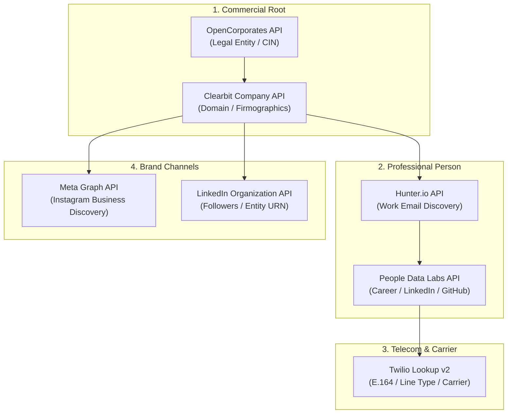

# 07 - Entity Resolution, Identity Graph & Cross-Platform Intelligence Endpoints

> **Document ID:** `CRAWLER-07`  
> **Tags:** `#entity-resolution` `#identity-graph` `#b2b-enrichment` `#cross-platform` `#telemetry-endpoints` `#e164-validation`

---

## 🎯 Executive Summary

Cross-platform intelligence requires bridging fragmented data nodes across disparate digital ecosystems: **domain names, registered corporate entities, professional identities (LinkedIn), corporate email infrastructure, phone/mobile carriers (E.164), and brand social presences (Instagram)**.

In modern data engineering, connecting these disparate signals is achieved through **Entity Resolution Pipelines** operating on an **Identity Graph (ID Graph)**. Rather than relying on closed data silos, systems engineers query programmatic REST gateways, DNS-over-HTTPS registries, carrier HLR gateways, and developer graph APIs to stitch a deterministic, 360-degree intelligence record.

---

## 🏢 1. Company & Legal Entity Resolution Endpoints

Every organization begins with a legal registration and root digital domain. These endpoints establish the root parent node in the graph.

### A. OpenCorporates REST API (Global Legal Entity Registry)
```http
GET https://api.opencorporates.com/v0.4/companies/search?q={company_name}&jurisdiction_code=in
Authorization: Bearer {OPENCORPORATES_API_KEY}
```

#### JSON Payload Extracted:
```json
{
  "api_version": "0.4",
  "results": {
    "companies": [
      {
        "company": {
          "name": "TENSIX DIGITAL PRIVATE LIMITED",
          "company_number": "U72900GJ2026PTC123456",
          "jurisdiction_code": "in",
          "incorporation_date": "2026-02-14",
          "registered_address_in_full": "S.G. Highway, Ahmedabad, Gujarat, India",
          "current_status": "Active",
          "officers": [
            { "name": "Managing Director", "role": "Director" }
          ]
        }
      }
    ]
  }
}
```

---

### B. Clearbit / HubSpot Company Enrichment API
Enriches a raw web domain (`tensix.in`) into a commercial technology and firmographic profile:

```http
GET https://company.clearbit.com/v2/companies/find?domain={domain}
Authorization: Bearer {CLEARBIT_API_KEY}
```

#### Key Fields Extracted:
```json
{
  "name": "Tensix",
  "legalName": "Tensix Digital Private Limited",
  "domain": "tensix.in",
  "category": { "sector": "Information Technology", "industry": "Software Engineering" },
  "metrics": { "employees": 25, "estimatedAnnualRevenue": "$1M-$5M" },
  "linkedin": { "handle": "company/tensix" },
  "twitter": { "handle": "tensix_in" },
  "tech": ["cloudflare", "nginx", "python", "fastapi", "postgresql"]
}
```

---

## 👤 2. Professional & Identity Graph APIs (B2B Person Graph)

Links an individual's name, corporate domain, and executive role to a verified professional persona.

### A. People Data Labs (PDL) Person Enrichment API
Queries an identity graph of over 3 billion public B2B profiles:

```http
GET https://api.peopledatalabs.com/v1/person/enrich?email={work_email}&api_key={PDL_API_KEY}
```
*Alternate query parameters:* `phone=+919876543210`, `profile=linkedin.com/in/{username}`, or `name={full_name}&company={company_name}`.

#### Telemetry Payload Returned:
```json
{
  "status": 200,
  "data": {
    "full_name": "Hemal Patel",
    "first_name": "Hemal",
    "last_name": "Patel",
    "job_title": "Founder & Principal Systems Architect",
    "job_company_name": "Tensix",
    "job_company_website": "tensix.in",
    "linkedin_url": "https://linkedin.com/in/hemal9102",
    "github_url": "https://github.com/hemal9102",
    "work_email": "hemal@tensix.in",
    "mobile_phone": "+919876543210",
    "location_metro": "Ahmedabad, Gujarat, India"
  }
}
```

---

### B. Apollo.io B2B People Match API
Resolves partial names and company domains into direct professional contact channels:

```http
POST https://api.apollo.io/v1/people/match
Content-Type: application/json

{
  "api_key": "{APOLLO_API_KEY}",
  "first_name": "Hemal",
  "organization_name": "Tensix",
  "domain": "tensix.in"
}
```

---

## ✉️ 3. Corporate Email Discovery & Verification Gateways

Ensures corporate email addresses are mathematically verified against target mail servers without sending speculative messages.

### A. Hunter.io Email Finder API
Extracts company-wide email syntax patterns (`{first}.{last}@{domain}`) and direct mailbox addresses:

```http
GET https://api.hunter.io/v2/email-finder?domain={domain}&first_name={first_name}&last_name={last_name}&api_key={HUNTER_API_KEY}
```

#### JSON Response Schema:
```json
{
  "data": {
    "first_name": "Hemal",
    "last_name": "Patel",
    "email": "hemal@tensix.in",
    "score": 96,
    "domain": "tensix.in",
    "sources": [
      { "domain": "tensix.in", "uri": "https://tensix.in/about", "extracted_on": "2026-10-13" }
    ],
    "verification": { "status": "valid" }
  }
}
```

---

### B. ZeroBounce / Debounce Real-Time Verification Endpoint
Performs SMTP handshake checks (`HELO`, `MAIL FROM`, `RCPT TO`) to confirm active inbox existence:

```http
GET https://api.zerobounce.net/v2/validate?api_key={ZEROBOUNCE_API_KEY}&email={email}&ip_address=
```

---

## 📱 4. Mobile & Carrier Intelligence Endpoints (E.164)

Normalizes international phone numbers and queries Home Location Register (HLR) carrier networks to determine line type and telecom origin.

### A. Twilio Lookup API v2 (Carrier & Line Type Intelligence)
```http
GET https://lookups.twilio.com/v2/PhoneNumbers/+919876543210?Fields=line_type_intelligence,caller_name
Authorization: Basic {ACCOUNT_SID}:{AUTH_TOKEN}
```

#### Carrier Intelligence Payload:
```json
{
  "calling_country_code": "91",
  "country_code": "IN",
  "phone_number": "+919876543210",
  "national_format": "098765 43210",
  "valid": true,
  "line_type_intelligence": {
    "type": "mobile",
    "carrier_name": "Reliance Jio Infocomm Ltd (RJIL)",
    "mobile_country_code": "405",
    "mobile_network_code": "861"
  },
  "caller_name": {
    "caller_name": "HEMAL PATEL",
    "error_code": null
  }
}
```
* **Line Type Classification:**
  * `mobile`: Active SIM with SMS/voice capabilities.
  * `landline`: Fixed copper/fiber line.
  * `voip`: Virtual Twilio/Skype/Google Voice number (higher risk of botting).

---

### B. Numverify E.164 Validation API
```http
GET http://apilayer.net/api/validate?access_key={NUMVERIFY_API_KEY}&number=+919876543210&country_code=IN&format=1
```

---

## 📸 5. Brand Social Graph & Cross-Platform Discovery

Connects commercial domains to official brand channels across Instagram and LinkedIn.

### A. Meta Graph API — Instagram Business Discovery
Queries verified Instagram professional accounts linked to Facebook business entities:

```http
GET https://graph.facebook.com/v19.0/{INSTAGRAM_BUSINESS_ACCOUNT_ID}?fields=business_discovery.username({brand_handle}){id,username,name,biography,website,followers_count,media_count}&access_token={META_GRAPH_ACCESS_TOKEN}
```

#### Output Extracted:
```json
{
  "business_discovery": {
    "id": "17841401234567890",
    "username": "tensix.in",
    "name": "Tensix Digital Systems",
    "biography": "Industrial Web Engineering, AEO & Autonomous AI Agents. Ahmedabad, India.",
    "website": "https://www.tensix.in",
    "followers_count": 1420,
    "media_count": 48
  }
}
```

---

### B. LinkedIn Organization API
```http
GET https://api.linkedin.com/v2/organizations?q=vanityName&vanityName=tensix
Authorization: Bearer {LINKEDIN_OAUTH_TOKEN}
```
* **Output:** Official organization ID (`urn:li:organization:...`), primary domain, headquarters location, verified follower counts, and executive leadership listing.

---

## 🔄 6. The Unified Graph-Stitching Pipeline

Below is the automated Python pipeline that ties these disparate endpoints into a single, unified identity graph node:

```python
import requests
import json

class IdentityGraphResolver:
    def __init__(self, config):
        self.config = config

    def resolve(self, domain, first_name, last_name):
        print(f"[*] Resolving Entity Graph for {first_name} {last_name} @ {domain}...")

        # 1. Company Firmographics
        company_res = requests.get(
            f"https://company.clearbit.com/v2/companies/find?domain={domain}",
            headers={"Authorization": f"Bearer {self.config['clearbit_key']}"}
        ).json()
        
        # 2. Corporate Email Discovery
        email_res = requests.get(
            f"https://api.hunter.io/v2/email-finder?domain={domain}&first_name={first_name}&last_name={last_name}&api_key={self.config['hunter_key']}"
        ).json()
        work_email = email_res.get("data", {}).get("email")

        # 3. Person Professional Graph (PDL)
        person_res = requests.get(
            f"https://api.peopledatalabs.com/v1/person/enrich?email={work_email}&api_key={self.config['pdl_key']}"
        ).json().get("data", {})

        # 4. Phone Validation & Carrier Intelligence
        phone_number = person_res.get("mobile_phone")
        phone_intel = {}
        if phone_number:
            phone_intel = requests.get(
                f"https://lookups.twilio.com/v2/PhoneNumbers/{phone_number}?Fields=line_type_intelligence,caller_name",
                auth=(self.config["twilio_sid"], self.config["twilio_token"])
            ).json()

        # 5. Composite Identity Graph Object
        identity_graph_node = {
            "entity": {
                "legal_name": company_res.get("legalName") or company_res.get("name"),
                "domain": domain,
                "sector": company_res.get("category", {}).get("sector"),
                "tech_stack": company_res.get("tech", []),
                "linkedin_company": company_res.get("linkedin", {}).get("handle"),
            },
            "person": {
                "full_name": f"{first_name} {last_name}",
                "work_email": work_email,
                "email_confidence": email_res.get("data", {}).get("score"),
                "job_title": person_res.get("job_title"),
                "linkedin_profile": person_res.get("linkedin_url"),
                "github_profile": person_res.get("github_url"),
            },
            "telecom": {
                "e164_phone": phone_number,
                "line_type": phone_intel.get("line_type_intelligence", {}).get("type"),
                "carrier": phone_intel.get("line_type_intelligence", {}).get("carrier_name"),
            }
        }

        return identity_graph_node
```

---

## ⚖️ 7. Compliance, Data Governance & Ethical Guardrails

When engineering identity resolution pipelines, strict adherence to legal and regulatory frameworks is mandatory:

1. **B2B vs Personal PII:** Processing public commercial contact information (corporate work emails `@company.com`, professional titles, company phone lines) is permitted under legitimate interest provisions (EU GDPR Art. 6(1)(f), US CAN-SPAM Act).
2. **India DPDP Act (2023) Compliance:** Personal identifiable information (private residential addresses, non-public consumer mobile numbers) requires express data fiduciary consent before processing.
3. **Anti-Scraping & Platform Terms:** Direct unauthenticated scraping of private social graphs violates Meta and LinkedIn developer platform agreements. Always utilize verified developer Graph APIs, partner enrichment nodes (PDL, Clearbit), or public corporate registries.

---

## 🗺️ 8. Complete Multi-Node Identity Graph Topology



---
**Backlinks:**
* [[06-AI-Search-and-Crawler-Engine/00 - Index|Master Domain Index]]
* [[06-AI-Search-and-Crawler-Engine/05 - Competitor Reverse-Engineering & Ranking Outflank Endpoints|05 - Competitor Outflank Endpoints]]
* [[06-AI-Search-and-Crawler-Engine/06 - MTA Deliverability, RFC Gateways & Mailbox Interrogation Endpoints|06 - MTA Deliverability & RFC Gateways]]
