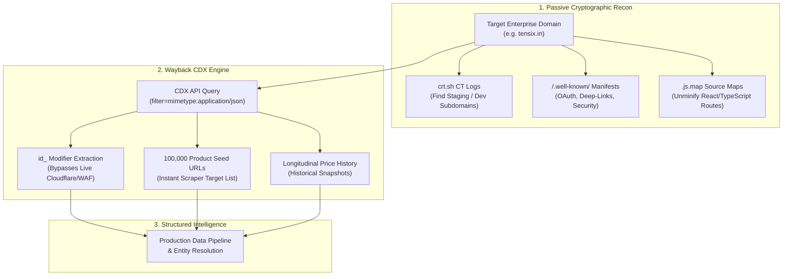

# 08 - Hidden Infrastructure Reconnaissance, Google Dorking & Wayback CDX Scraping

> **Document ID:** `CRAWLER-08`  
> **Tags:** `#reconnaissance` `#certificate-transparency` `#google-dorking` `#wayback-cdx` `#data-scraping` `#osint` `#source-maps`

---

## 🎯 Executive Summary

The modern web is built on layers of cryptographic ledgers, historical crawler archives, mobile interoperability manifests, and public routing tables. While corporate targets invest heavily in client-side anti-bot platforms (Cloudflare Turnstile, DataDome, Akamai), their infrastructure, staging environments, internal APIs, and catalog data remain permanently exposed across **unindexed, public telemetry protocols**.

By querying Certificate Transparency logs, interrogating the Wayback Machine CDX index, extracting client-side source maps, and applying targeted search operators, systems engineers can discover hidden API endpoints, bypass anti-bot shields without rotating proxies, and harvest millions of structured catalog records in minutes.

---

## 🔬 PART 1: The Hidden Infrastructure Reconnaissance Layers

---

### 1. Certificate Transparency (CT) Logs (RFC 6962)

* **What it is:** Every time an organization issues an SSL/TLS certificate (via Let's Encrypt, Cloudflare, DigiCert, Sectigo), Certificate Authorities are mandated by Google Chrome and Apple to append the certificate to a public, append-only, tamper-proof cryptographic ledger.
* **Why it's hidden in plain sight:** Development teams frequently create subdomains such as `staging-api.tensix.in`, `internal-dev.tensix.in`, `vpn.tensix.in`, or `admin-v2.tensix.in` under the false assumption that without public hyperlinks, these hosts remain secret. The moment an automated SSL certificate is minted, it is broadcast to the world within seconds.
* **The Interrogation Endpoint:**
  ```http
  GET https://crt.sh/?q=%.tensix.in&output=json
  ```

#### Real-World Example (cURL & JQ):
```bash
curl -s "https://crt.sh/?q=%.tensix.in&output=json" | jq -r '.[].name_value' | sort -u
```
* **Sample Output:**
  ```text
  admin.tensix.in
  api-staging.tensix.in
  internal-metrics.tensix.in
  mail.tensix.in
  mta-sts.tensix.in
  www.tensix.in
  ```

#### Real-Time Streaming via Certstream (WebSocket):
Certstream provides an open WebSocket firehose streaming every SSL certificate minted globally:
```python
import certstream

def print_callback(message, context):
    if message['message_type'] == "certificate_update":
        all_domains = message['data']['leaf_cert']['all_domains']
        for domain in all_domains:
            if "tensix" in domain or "competitor" in domain:
                print(f"[!] New Infrastructure Detected: {domain}")

certstream.listen_for_events(print_callback, url="wss://certstream.calidog.io/")
```
* **Strategic Utility:** Detects competitor product branches, microservices, and regional expansions the instant their SSL certificate is registered.

---

### 2. Historical Route & URL Mining (Wayback Machine CDX API)

* **What it is:** The Internet Archive stores not just rendered HTML pages, but raw index snapshots of every URL, API route, parameter permutation, and file path requested by its spiders across 25+ years.
* **The Interrogation Endpoint:**
  ```http
  GET http://web.archive.org/cdx/search/cdx?url=*.target.com/*&output=json&fl=original&collapse=urlkey
  ```
* **What it reveals:**
  * Deprecated API endpoints still live on backend servers (e.g., `/api/v1/user/export`) but omitted from contemporary documentation.
  * Historical query parameter formats (`?debug=true`, `?version=legacy`).
  * Forgotten staging directories and internal PDF whitepapers.

---

### 3. Client-Side Source Maps (`.js.map` Leakage)

* **What it is:** Modern Single Page Applications (React, Vue, Next.js, Angular, Vite) bundle and minify frontend source code into files like `main.4f8a9b.js`. Build pipelines frequently generate `.js.map` source maps for debugging.
* **The Exposure:**
  * CI/CD pipelines often forget to exclude `.map` files during production artifact deployment to public S3 or Cloudflare buckets.
  * Adding `.map` to any frontend bundle URL:
    ```http
    GET https://target.com/static/js/main.chunk.js.map
    ```
* **Reconstruction Example:**
  ```bash
  # Install un-sourcemap utility
  npm install -g reverse-sourcemap
  
  # Download and reconstruct entire developer source directory
  curl -s "https://target.com/static/js/main.chunk.js.map" -o bundle.map
  reverse-sourcemap --output-dir ./reconstructed_src bundle.map
  ```
* **What it reveals:** Reconstructs the exact unminified TypeScript/React project structure, including internal route constants, developer comments, private staging backend URLs, and unreleased feature flags.

---

### 4. RFC Well-Known & Mobile Deep-Link Manifests

Standardized protocols mandate publicly accessible configuration files placed under `/.well-known/` to facilitate browser, Android, and iOS interoperability:

#### A. OpenID / OAuth2 Auto-Discovery (RFC 8414)
```http
GET https://target.com/.well-known/openid-configuration
```
* *Payload Disclosed:* Token endpoints (`/oauth/token`), authorization routes, userinfo handlers, and JWKS public keys.

#### B. Android App Links (Digital Asset Links)
```http
GET https://target.com/.well-known/assetlinks.json
```
* *Payload Disclosed:*
```json
[
  {
    "relation": ["delegate_permission/common.handle_all_urls"],
    "target": {
      "namespace": "android_app",
      "package_name": "com.target.android.app",
      "sha256_cert_fingerprints": [
        "14:6D:E9:..."
      ]
    }
  }
]
```
* *Utility:* Exposes the target's exact private Android package namespace and build signing fingerprints.

#### C. Apple Universal Links (Apple App Site Association)
```http
GET https://target.com/.well-known/apple-app-site-association
```
* *Payload Disclosed:*
```json
{
  "applinks": {
    "apps": [],
    "details": [
      {
        "appID": "9JA89QQLKW.com.target.ios",
        "paths": ["/checkout/*", "/account/*", "/invite/*"]
      }
    ]
  }
}
```
* *Utility:* Details all internal mobile application route patterns and Apple Team IDs.

#### D. Security Vulnerability Disclosure (RFC 9116)
```http
GET https://target.com/.well-known/security.txt
```
* *Payload Disclosed:* Security team contacts, PGP public keys, and vulnerability disclosure policies.

---

### 5. Advanced Search Operators ("Google Dorking")

Search engine spiders traverse and index unauthenticated files exposed through lax permissions or missing `robots.txt` disallows.

#### A. Interactive Swagger / OpenAPI Documentation
```text
site:target.com inurl:swagger-ui | inurl:api-docs | inurl:"/docs/v1"
site:target.com filetype:json inurl:openapi
```
* *Result:* Uncovers interactive documentation of all backend REST endpoints, parameter types, and authentication schemes.

#### B. Open Directory Listings (Apache / Nginx Indexes)
```text
site:target.com intitle:"Index of /" | intitle:"Index of /uploads"
```
* *Result:* Clickable directory trees containing unlinked assets, database backups (`.sql`), and server logs.

#### C. Staging & Subdomain Filtering
```text
site:*.target.com -www.target.com -target.com
site:target.com inurl:dev | inurl:staging | inurl:test | inurl:beta
```
* *Result:* Surfaces internal environments indexed before authentication firewalls were established.

#### D. Public Cloud Storage References
```text
site:s3.amazonaws.com "target.com"
site:storage.googleapis.com "target.com"
```
* *Result:* Locates publicly accessible cloud buckets hosting company documents, backups, or raw exports.

---

### 6. Border Gateway Protocol (BGP) & ASN Mapping

Instead of analyzing a single origin IP address:
* Major enterprises and hosting providers operate under an **Autonomous System Number (ASN)** (e.g., `AS13335` for Cloudflare, `AS15169` for Google).
* **Interrogation Endpoints:**
  ```http
  GET https://bgp.he.net/AS{ASN}
  GET https://stat.ripe.net/data/announced-prefixes/data.json?resource=AS{ASN}
  ```
* *Result:* Maps every CIDR netblock (e.g., `/24`, `/16`), adjacent peering node, and regional data center owned by the organization.

---

### 7. DNS Wildcards & Zone Transfer (AXFR) Residuals

* **DNS Zone Transfers (AXFR - RFC 5936):**
  If a DNS administrator leaves AXFR open to the public, querying the nameserver dumps the complete DNS zone:
  ```bash
  dig AXFR @ns1.target.com target.com
  ```
* **DNS-over-HTTPS SRV Record Enumeration:**
  Identifies internal cluster services running on custom ports without port scanning:
  ```http
  GET https://dns.google/resolve?name=_sip._tcp.target.com&type=SRV
  GET https://dns.google/resolve?name=_autodiscover._tcp.target.com&type=SRV
  ```

---

### 📊 Reconnaissance Layer Matrix

| Layer | Primary Source | Exposed Assets |
| :--- | :--- | :--- |
| **CT Logs (RFC 6962)** | `crt.sh`, Certstream | Every staging and internal subdomain issued with TLS |
| **Wayback CDX API** | Internet Archive | Historical endpoints, deprecated APIs, past file paths |
| **Source Maps (`.map`)** | Public Webpack/Vite assets | Original frontend source code, internal routes, dev comments |
| **Well-Known RFCs** | `/.well-known/` | OAuth configurations, iOS/Android deep-link structures |
| **Search Operators** | Google / Bing Dorks | Unprotected Swagger specs, open directory listings |
| **BGP / ASN Tables** | BGP Routeviews, RIPE | Complete netblocks, IP ranges, and sibling infrastructure |
| **DNS SRV Records** | DoH (`dns.google`) | Internal port numbers, VoIP/SIP gateways, autodiscover hosts |

---

## ⚡ PART 2: Weaponizing Wayback CDX for High-Throughput Data Scraping

The **Wayback Machine CDX API** serves as an ultra-high-efficiency data extraction engine for web scrapers.

When crawling large targets (e-commerce catalogs, corporate directories, pricing tables), live scrapers face three major barriers:
1. **Anti-Bot Defenses:** Cloudflare Turnstile, DataDome, and Akamai rate-limit or captcha scrapers.
2. **Infinite Navigation:** Client-side JavaScript hides pagination behind dynamic state.
3. **Data Attrition:** Deleted products, legacy pricing, and discontinued SKUs disappear from live sites.

The CDX API overcomes all three.

---

### 1. The `id_` Modifier: Bypassing Anti-Bot Walls via the Archive

When querying the Wayback Machine directly:
* **Standard URL (Includes Wayback headers, toolbars, and JS wrappers):**
  `https://web.archive.org/web/20260115000000/https://target.com/product/123`
* **Raw Unmodified Output (The `id_` Modifier):**
  `https://web.archive.org/web/20260115000000id_/https://target.com/product/123`

Appending `id_` immediately after the 14-digit timestamp instructs Wayback to serve the **exact byte-for-byte HTML/JSON payload originally received from the server**, stripping all Wayback navigation elements.

* **Operational Benefit:** You scrape the Internet Archive’s CDN (`web.archive.org`), bypassing the target’s live WAF, IP bans, and rate limits entirely.

---

### 2. Hunting for Hidden JSON APIs (`filter=mimetype:application/json`)

Many modern web platforms fetch catalog data through internal, unauthenticated JSON APIs. The CDX API indexes the exact MIME type of every file it captured:

```http
GET http://web.archive.org/cdx/search/cdx?url=*.target.com/*&output=json&filter=mimetype:application/json&filter=statuscode:200&collapse=urlkey&limit=500
```

#### Raw Telemetry Returned:
```json
[
  ["urlkey", "timestamp", "original", "mimetype", "statuscode", "digest", "length"],
  ["com,target)/api/catalog/products?cat=42", "20260410123000", "https://target.com/api/catalog/products?cat=42", "application/json", "200", "A3...", "4201"],
  ["com,target)/api/v1/pricing/bulk", "20260301112000", "https://target.com/api/v1/pricing/bulk", "application/json", "200", "B7...", "18402"]
]
```

* **The Scraper Advantage:** Instead of writing fragile CSS/XPath selectors to parse messy HTML, you can query discovered JSON endpoints directly or fetch their archived responses as clean JSON data.

---

### 3. Extracting 100,000 Catalog URLs Without Writing a Spider

Spidering infinite-scroll or heavily paginated catalogs is prone to timeouts. The CDX index can be queried to produce a deduplicated catalog URL seed list instantly:

```http
GET http://web.archive.org/cdx/search/cdx?url=target.com/product/*&output=json&fl=original&collapse=urlkey&filter=statuscode:200
```
* `url=target.com/product/*`: Wildcard prefix for the target product directory.
* `fl=original`: Instructs the engine to return only the URL string, eliminating timestamp overhead.
* `collapse=urlkey`: Automatically deduplicates repeating URLs across crawl dates.

* **Result:** Returns 50,000–100,000 validated product URLs in **under 5 seconds**, ready to be fed directly into your extraction queue.

---

### 4. Hunting for Leaked Data Files (`csv`, `xlsx`, `sql`, `json`)

Developers occasionally publish internal spreadsheets or catalog dumps to public directories before removing them:

```http
GET http://web.archive.org/cdx/search/cdx?url=*.target.com/*&output=json&fl=original&filter=original:.*\.(csv|xlsx|json|tsv)$&collapse=urlkey
```
* **Result:** Dumps direct download URLs for all archived structured data files.

---

### 5. Time-Series Scraping (Historical Price Tracking)

To construct competitive pricing models over time:

1. Query CDX for all crawl timestamps of a product or pricing page:
   ```http
   GET http://web.archive.org/cdx/search/cdx?url=target.com/pricing&output=json&fl=timestamp,original&filter=statuscode:200
   ```
2. The endpoint returns the historical timeline:
   * `20240115000000`
   * `20240715000000`
   * `20250115000000`
   * `20260115000000`
3. Fetch `https://web.archive.org/web/{timestamp}id_/https://target.com/pricing` for each snapshot.
4. Extract the historical pricing values to generate longitudinal pricing curves without having monitored the site in past years.

---

### 6. Full Python Pipeline: Automated CDX Scraper Harvester

```python
import requests
import json

class WaybackCDXHarvester:
    BASE_URL = "http://web.archive.org/cdx/search/cdx"

    def __init__(self, domain):
        self.domain = domain

    def extract_json_apis(self, limit=100):
        """Discovers internal JSON API endpoints archived for the domain."""
        print(f"[*] Discovering JSON APIs for {self.domain}...")
        params = {
            "url": f"*.{self.domain}/*",
            "output": "json",
            "fl": "timestamp,original,mimetype",
            "filter": ["statuscode:200", "mimetype:application/json"],
            "collapse": "urlkey",
            "limit": limit
        }
        res = requests.get(self.BASE_URL, params=params)
        if res.status_code != 200:
            return []
        
        data = res.json()
        if len(data) <= 1:
            return []

        results = []
        for row in data[1:]:
            timestamp, original_url, mime = row
            raw_url = f"https://web.archive.org/web/{timestamp}id_/{original_url}"
            results.append({
                "original_url": original_url,
                "raw_archive_url": raw_url,
                "mimetype": mime
            })
        return results

    def extract_product_seed_list(self, path_prefix="/product/*", limit=5000):
        """Extracts complete catalog URLs deduplicated across all dates."""
        print(f"[*] Harvesting seed URLs for {self.domain}{path_prefix}...")
        params = {
            "url": f"{self.domain}{path_prefix}",
            "output": "json",
            "fl": "original",
            "filter": "statuscode:200",
            "collapse": "urlkey",
            "limit": limit
        }
        res = requests.get(self.BASE_URL, params=params)
        if res.status_code != 200:
            return []
        
        data = res.json()
        if len(data) <= 1:
            return []

        # Header row is ['original'], slice from index 1
        urls = [row[0] for row in data[1:]]
        return urls

    def get_historical_snapshots(self, target_url):
        """Returns all historical timestamps for longitudinal tracking."""
        params = {
            "url": target_url,
            "output": "json",
            "fl": "timestamp",
            "filter": "statuscode:200"
        }
        res = requests.get(self.BASE_URL, params=params)
        if res.status_code != 200:
            return []
        
        data = res.json()
        if len(data) <= 1:
            return []
        
        timestamps = [row[0] for row in data[1:]]
        raw_snapshot_urls = [
            f"https://web.archive.org/web/{ts}id_/{target_url}"
            for ts in timestamps
        ]
        return raw_snapshot_urls


if __name__ == "__main__":
    harvester = WaybackCDXHarvester("tensix.in")
    
    # 1. Harvest JSON APIs
    apis = harvester.extract_json_apis(limit=5)
    print(f"[+] Found {len(apis)} API endpoints.")
    print(json.dumps(apis, indent=2))
```

---

## 🗺️ Visual Architecture: The Complete Reconnaissance & Ingestion Loop



---
**Backlinks:**
* [[06-AI-Search-and-Crawler-Engine/00 - Index|Master Domain Index]]
* [[06-AI-Search-and-Crawler-Engine/05 - Competitor Reverse-Engineering & Ranking Outflank Endpoints|05 - Competitor Outflank Endpoints]]
* [[06-AI-Search-and-Crawler-Engine/06 - MTA Deliverability, RFC Gateways & Mailbox Interrogation Endpoints|06 - MTA Deliverability & RFC Gateways]]
* [[06-AI-Search-and-Crawler-Engine/07 - Entity Resolution, Identity Graph & Cross-Platform Intelligence Endpoints|07 - Entity Resolution & Identity Graph]]
