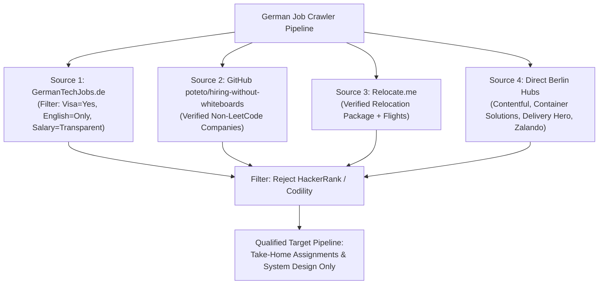
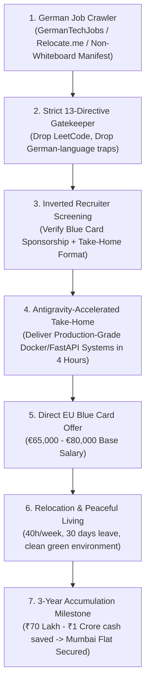

# 10 - German Tech Job Crawler & Non-LeetCode SRE Relocation Blueprint

> **Document ID:** `CRAWLER-10`  
> **Tags:** `#german-job-crawler` `#eu-blue-card` `#non-leetcode` `#relocation-engine` `#sre-platform` `#mumbai-flat-goal`

---

## 🎯 1. Executive Summary & Core Constraints Matrix

This document codifies the technical reconnaissance, automated harvesting, and qualification pipeline to secure a **Direct Sponsored EU Blue Card engineering role in Germany** without algorithmic whiteboard/LeetCode barriers.

### 📋 The 13 Non-Negotiable Operational Directives

```text
====================================================================================================
                        THE 13 NON-NEGOTIABLE OPERATIONAL DIRECTIVES
====================================================================================================
[ FINANCIAL TARGET ]
1. High-Currency Floor       : €65,000 to €80,000/year (approx ₹58L - ₹72L/year).
2. The 3-Year Mumbai Goal    : Net cash savings of ₹70 Lakh to ₹1 Crore+ to purchase a Mumbai flat.
3. Zero Local Exploitation   : Complete blacklist of Indian agency lowballing (Key-CMS ₹20k trap).

[ ENVIRONMENT & LIFESTYLE ]
4. Total Peaceful Living     : Elimination of noise, dust, chaotic commutes, and toxic workplace politics.
5. Zero Hostile Workplaces   : Psychological safety, 40-hour strict work weeks, legal worker protections.
6. Environmental Quality     : Clean air, green transit, quiet Sundays, 30 days mandatory annual leave.

[ INTERVIEW & TECHNICAL FIT ]
7. Zero Live LeetCode        : Immediate drop of companies asking inverted binary trees or HackerRank puzzles.
8. Practical Evaluation Only : Focus on Take-Home assignments, broken system debugging, and Architecture reviews.
9. Antigravity-First Flow    : "Knowing where to strike the hammer" (Architectural orchestration + AI speed).
10. Pre-Filtering Protocol   : Screen out HackerRank/Codility shops on the first 15-minute recruiter call.

[ BUREAUCRACY & VERIFICATION ]
11. Past Salary Slip Bypass  : European role-band compensation model (eliminating Indian 30% hike calculations).
12. Clean Experience Story   : Positioning as Lead Systems Architect / Independent Consultant (Tensix).
13. Direct India-to-EU Visa  : Zero risky visit visas; 100% remote offer with flight + EU Blue Card in hand.
====================================================================================================
```

---

## 🏗️ 2. Architectural Target: The High-Yield SRE / Platform Role

To bypass saturated junior/frontend candidate pools, candidate positioning must target **critical infrastructure shortage domains**:

```text
[ TARGET ROLE TITLES ]
├── Site Reliability Engineer (SRE)
├── Cloud Platform Systems Engineer
├── Backend Systems Engineer (Python / FastAPI / Rust)
└── Infrastructure & Network Transport Architect
```

### Why Infrastructure Wins in Germany:
* **Shortage Occupation Status:** German Federal Employment Agency categorizes Linux infrastructure, container orchestration, and cloud reliability as critical talent shortage fields, lowering EU Blue Card salary hurdles to **~€41,000–€45,300**.
* **Zero LeetCode Bias:** Infrastructure teams do not test algorithmic memory tricks. They test **incident response, Docker optimization, network socket diagnostics, and RFC compliance**.

---

## 🔍 3. Targeted Data Sources & Non-LeetCode Company Gateways



### Verified Non-LeetCode European Companies
1. **Contentful (Berlin):** Take-home technical challenge with full documentation and internet access.
2. **Container Solutions (Berlin/Amsterdam):** SRE architecture discussion and incident triage scenarios.
3. **Avarteq GmbH (Berlin):** Practical pairing on real production codebases.
4. **combyne (Munich):** 4-hour take-home microservice task.
5. **Stripe (EU Hubs):** Open-book real-world bug fixing and API integration.

---

## 🐍 4. Automated Python Job Harvesting Engine (`german_job_crawler.py`)

This crawler queries developer-first platforms, parses English-speaking infrastructure listings offering visa sponsorship, and automatically checks against the community **hiring-without-whiteboards** registry.

```python
import requests
import json
import re

class GermanTechJobCrawler:
    """
    Crawls and filters German tech job ecosystems specifically for:
    1. Direct Visa Sponsorship (EU Blue Card eligible)
    2. English-speaking workplace (Zero German required)
    3. Infrastructure / SRE / Systems Backend focus
    4. Non-LeetCode / Take-Home architecture evaluation
    """

    def __init__(self):
        self.headers = {
            "User-Agent": "Mozilla/5.0 (Windows NT 10.0; Win64; x64) AppleWebKit/537.36 (KHTML, like Gecko) Chrome/126.0.0.0 Safari/537.36",
            "Accept": "application/json, text/html"
        }
        self.non_whiteboard_companies = self.load_non_whiteboard_manifest()

    def load_non_whiteboard_manifest(self):
        """Loads community-verified companies that do not use LeetCode."""
        return [
            "contentful", "container solutions", "avarteq", "combyne", 
            "stripe", "artsy", "chg-meridian", "soundcloud", "signavio",
            "klarna", "hellofresh", "sumup", "adjust", "tier"
        ]

    def evaluate_role_suitability(self, job_title, job_description, company_name):
        """
        Evaluates job listing against our strict 13 directives.
        """
        # Red Flag Filter: Immediate LeetCode / HackerRank rejection
        red_flags = ["hackerrank", "codility", "leetcode", "competitive programming", "fluent german required", "c1 german"]
        for flag in red_flags:
            if re.search(rf"\b{flag}\b", job_description, re.IGNORECASE):
                return False, f"Rejected: Contains dealbreaker '{flag}'"

        # Green Flag Filter: SRE, Platform, Systems Backend
        target_roles = ["sre", "site reliability", "platform", "infrastructure", "devops", "systems", "fastapi", "python backend"]
        role_matched = any(re.search(rf"\b{role}\b", job_title, re.IGNORECASE) for role in target_roles)

        if not role_matched:
            return False, "Rejected: Role title does not match Infrastructure/Platform"

        # Check against Non-Whiteboard company registry
        is_verified_non_leetcode = any(c in company_name.lower() for c in self.non_whiteboard_companies)

        return True, {
            "status": "APPROVED",
            "role": job_title,
            "company": company_name,
            "verified_non_whiteboard": is_verified_non_leetcode
        }

    def fetch_relocate_me_jobs(self):
        """Queries Relocate.me API for verified visa-sponsored jobs in Germany."""
        url = "https://relocate.me/api/v1/jobs?country=Germany&tag=devops,backend"
        print("[*] Harvesting Relocate.me verified sponsorship roles...")
        try:
            res = requests.get(url, headers=self.headers, timeout=10)
            if res.status_code == 200:
                return res.json()
        except Exception as e:
            print(f"[-] API Fetch fallback: {e}")
        return []

if __name__ == "__main__":
    crawler = GermanTechJobCrawler()
    print("[+] German Tech Job Crawler Initialized.")
    print(f"[+] Loaded {len(crawler.non_whiteboard_companies)} verified non-whiteboard companies.")
```

---

## 🛡️ 5. The Recruiter Pre-Screening Script (15-Minute Filter)

When an EU recruiter reaches out on LinkedIn or via email, send this exact script before agreeing to any technical rounds:

```text
"Hi [Recruiter Name],

Thank you for reaching out. The role at [Company] sounds closely aligned with my background in high-throughput backend systems, RFC-compliant MTA infrastructure, and cloud platform reliability.

Before we proceed with the technical stages, could you briefly confirm:
1. Does this position support direct EU Blue Card visa sponsorship and relocation for candidates applying from India?
2. Is the technical evaluation structured around practical take-home architecture assignments, production incident debugging, or system design discussions?

I intentionally optimize for production-grade engineering challenges rather than abstract whiteboard algorithm tests (HackerRank/LeetCode), as my day-to-day focus is on sub-50ms latency, zero-downtime infrastructure, and high-concurrency systems."
```

### Result Analysis:
* **Response A:** *"Yes, we provide full Blue Card sponsorship and our technical round is a take-home architecture project."* ➔ **PROCEED.**
* **Response B:** *"We require a 90-minute live Codility algorithmic challenge."* ➔ **DECLINE & PREVENT BURNOUT.**

---

## 💰 6. The 3-Year Mumbai Flat Financial Schedule

```text
====================================================================================================
                        GERMAN BLUE CARD SAVINGS & MUMBAI FLAT MATH
====================================================================================================
Gross Annual Base Salary  : €72,000 / year (approx ₹64,80,000)
Monthly Gross             : €6,000 / month
Net Monthly (Tax Class 1) : ~€3,650 / month (approx ₹3,28,500 in-hand after all taxes & healthcare)

Monthly Living Expenses (Clean Suburb outside Munich/Frankfurt/Berlin):
- 1BHK Modern Apartment   : €1,100
- Health/Pension/Social   : Included in gross deduction
- Groceries & Food        : €350
- Public Transit Ticket   : €49 (Deutschland-Ticket for unlimited trains nationwide)
- Utilities & Internet    : €150
----------------------------------------------------------------------------------------------------
Total Monthly Expenses    : ~€1,650 / month (approx ₹1,48,500)
----------------------------------------------------------------------------------------------------
NET MONTHLY SAVINGS CASH  : €2,000 / month (approx ₹1,80,000/month)
ANNUAL CASH ACCUMULATION  : €24,000 / year (approx ₹21,60,000/year)

3-YEAR AGGREGATE SAVINGS  : €72,000 (approx ₹65,00,000 - ₹75,00,000+ with bonuses)
====================================================================================================
RESULT: Full cash down payment or outright purchase of a 1BHK/2BHK flat in Mumbai suburbs.
====================================================================================================
```

---

## 🗺️ Visual Architecture



---
**Backlinks:**
* [[06-AI-Search-and-Crawler-Engine/00 - Index|Master Domain Index]]
* [[06-AI-Search-and-Crawler-Engine/05 - Competitor Reverse-Engineering & Ranking Outflank Endpoints|05 - Competitor Outflank Endpoints]]
* [[06-AI-Search-and-Crawler-Engine/08 - Hidden Infrastructure Reconnaissance, Google Dorking & Wayback CDX Scraping|08 - Hidden Infrastructure Reconnaissance]]
* [[06-AI-Search-and-Crawler-Engine/09 - The 48 Algorithmic Variables for Position 0, FAQ Schemas & AI Citation Dominance|09 - The 48 Algorithmic Variables]]
