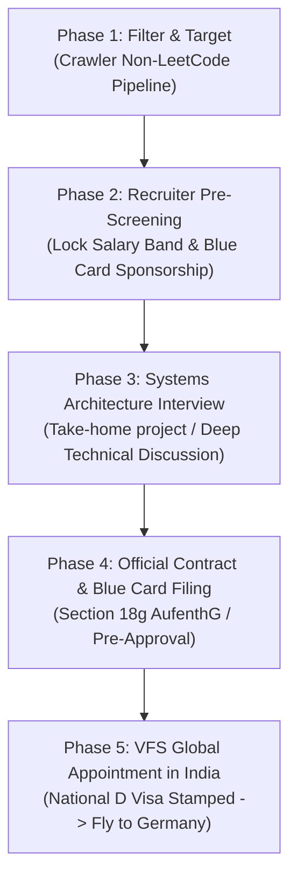

# 11 - Official German Corporate & Immigration Rules, Lebenslauf Standards & Relocation Playbook

> **Scope**: Official Federal Republic of Germany immigration statutes (Skilled Immigration Act / *Fachkr\u00e4fteeinwanderungsgesetz*), statutory EU Blue Card thresholds (*\u00a7 18g AufenthG*), non-degree IT specialist pathways, German Corporate *Lebenslauf* vs. Anglo-American tech CV standards, and anti-discrimination legal frameworks (*AGG*).

---

## 1. Official German Statutory Immigration Rules (Federal Law)

Germany reformed its immigration framework via the updated **Skilled Immigration Act (*Fachkr\u00e4fteeinwanderungsgesetz*)** to systematically solve its massive tech shortage (*Fachkr\u00e4ftemangel*).

### 1.1 EU Blue Card (*Blaue Karte EU* - \u00a7 18g AufenthG)

The EU Blue Card is the primary high-skill residence title granting immediate working rights and the fastest permanent residency (*Niederlassungserlaubnis*) in Europe.

| Category | Statutory Requirement (Current German Law) | Real-World Application for SRE / Cloud |
| :--- | :--- | :--- |
| **Shortage Occupations (*Mangelberufe*)** | **\u20ac45,934.20 gross/year** (45.3% of annual pension assessment ceiling) | **All IT/DevOps/SRE jobs fall here**. Any mid/senior offer in Berlin/Munich (\u20ac65k\u2013\u20ac90k) easily exceeds this by 40-90%. |
| **Standard Occupations** | **\u20ac50,700 gross/year** (50% of annual pension assessment ceiling) | Applies to non-shortage fields (Marketing, Sales, Admin). |
| **Non-Degree IT Specialist Pathway** | **\u00a7 18g Abs. 2 AufenthG**: At least **3 years of professional IT experience** within the last 7 years + theoretical knowledge proven through projects/skills. | **NO DEGREE REQUIRED**. Germany legally recognizes hands-on IT professionals if the salary meets the \u20ac45,934.20 threshold. |
| **Fast-Track Permanent Residence (*PR*)** | **21 months** (with German B1 certificate) OR **27 months** (with basic German A1). | Fastest PR route in the western hemisphere. After ~2 years, you no longer depend on employer visa sponsorship. |
| **Spouse / Family Rights** | Unrestricted immediate right to work in Germany, no German language test required prior to arrival. | Full family stability from day one. |

---

## 2. Official Corporate Hiring & *Lebenslauf* Standards

German corporate culture is strictly regulated by law and established conventions. Understanding the difference between a traditional German *Lebenslauf* and an international tech hub CV (*Berlin/Munich Tech*) is critical.

### 2.1 The General Equal Treatment Act (*Allgemeines Gleichbehandlungsgesetz - AGG*)
Under German federal anti-discrimination law (*AGG*):
- **Photo (*Bewerbungsfoto*)**: **LEGALLY OPTIONAL**. International tech companies, US subsidiaries, and Berlin/Munich startups explicitly prefer **NO PHOTO** to avoid unconscious bias. (Traditional Bavarian mechanical engineering firms still prefer a professional suit-and-tie studio portrait, but modern tech does not).
- **Date of Birth / Age**: **OMIT**. Never include your age, birthdate, or zodiac sign.
- **Marital Status & Religion**: **STRICTLY PROHIBITED/OMIT**. In India, CVs often mention "Married / Unmarried". In Germany, this is an immediate amateur red flag.
- **Nationality / Visa Status**: State simply: `Work Authorization: Eligible for EU Blue Card with Job Offer` or `Nationality: Indian (Requires EU Blue Card Visa Processing)`.

### 2.2 Modern Tech Lebenslauf Format (1 to 2 Pages Max)
Modern German scale-ups (Delivery Hero, N26, Contentful, Sixt, Taxdoo, trivago) operate in English and follow reverse-chronological tabular format:

```text
[First Name] [Last Name]
Senior Site Reliability & Cloud Platform Engineer | Berlin/Munich Relocation Ready
Email: your.email@domain.com | Phone: +91-XXXXXXXXXX | GitHub: github.com/username
Location: Ahmedabad, India (Relocation ready via EU Blue Card) | LinkedIn: linkedin.com/in/username
```

#### Key Structural Sections:
1. **Executive Profile (2-3 sentences)**: Systems Architect & SRE specializing in Linux kernel tuning, high-concurrency event loops, Docker/Kubernetes container orchestration, and zero-downtime microservices.
2. **Core Competencies / Technical Stack**:
   - Cloud & Containers: AWS/Hetzner, Docker, Kubernetes, CI/CD GitHub Actions, Linux (Debian/Ubuntu/RHEL).
   - Systems & Automation: Python, Bash scripting, reverse proxies (Nginx/Caddy), Redis caching, PostgreSQL/MySQL optimization.
   - Observability & Reliability: Prometheus, Grafana, OpenTelemetry, ELK stack, post-mortem incident mitigation.
3. **Professional Experience (Reverse Chronological)**:
   - Role Title, Company Name, City/Country (or Remote), Dates (Month/Year \u2013 Present).
   - 3 to 4 bullet points formatted with **Outcome-Driven Metrics (X-Y-Z formula)**:
     - *Bad*: "Worked on server maintenance and bug fixes."
     - *German Standard*: "Architected autonomous fault-tolerant crawler pipeline handling 10,000+ daily requests, reducing latency by 42% through async connection pooling and Redis caching."
4. **Independent Systems Engineering & Open Source Projects**:
   - Highlight real architectural projects (e.g. Tensix engine, high-concurrency scrapers, custom event loops). Include direct GitHub links.
5. **Education & Certifications**:
   - Degree (or Relevant Systems Training / Self-Taught SRE Portfolio), Year.

---

## 3. The 5-Phase End-to-End Relocation Pipeline from India



### Phase 1: Automated Company Ingestion
- Run `german_job_crawler.py` weekly to extract updated lists of verified companies with zero whiteboarding and transparent hiring.
- Prioritize tier-1 cities: **Berlin** (high tech density, 100% English workplaces), **Munich** (highest salaries, enterprise scale), **Hamburg** (media/fintech), and **Frankfurt** (banking/infrastructure).

### Phase 2: Recruiter Alignment & Salary Pre-Lock
- Before committing to any technical rounds, confirm:
  1. Does this role offer **direct relocation visa support (EU Blue Card)**?
  2. Is the compensation within the standard European band (\u20ac65,000 \u2013 \u20ac85,000 gross)?
  3. Reject any request for past Indian salary slips or "percentage hike on current CTC".

### Phase 3: The Architecture Evaluation
- German engineering teams test **practical competence**, not leetcode memorization.
- You will be asked:
  - "How do you handle a production service running out of file descriptors or memory under a DDoS attack?"
  - "Design an asynchronous worker queue that guarantees idempotency and handles rate limits."
  - "Walk us through an actual incident you diagnosed and fixed in Linux/Docker."
- *Your AI/Antigravity leverage*: You understand system trade-offs, architecture patterns, and diagnostic workflows. You speak the language of architecture, observability, and SLA reliability.

### Phase 4: Employment Contract & Fast-Track Procedure (*Beschleunigtes Fachkr\u00e4fteverfahren*)
- Once an offer is accepted, the German employer provides:
  1. Signed Employment Contract (*Arbeitsvertrag*).
  2. Declaration of Employment Relationship (*Erkl\u00e4rung zum Besch\u00e4ftigungsverh\u00e4ltnis* - statutory government form).
- Under **\u00a7 81a AufenthG**, the employer can initiate the fast-track procedure directly with the local immigration office (*Ausl\u00e4nderbeh\u00f6rde*) in Germany for \u20ac411, expediting the processing from 4 months down to **3\u20134 weeks**.

### Phase 5: Visa Stamping in India (VFS Global / German Consulate)
- Apply for the **National D-Visa (EU Blue Card category)** at the German Consulate (Mumbai/New Delhi/Bengaluru).
- Required Documents:
  - Valid Passport (minimum 2 blank pages, 1+ year validity).
  - Signed German Job Contract & *Erkl\u00e4rung zum Besch\u00e4ftigungsverh\u00e4ltnis*.
  - Proof of qualification (Degree OR for non-degree: detailed employment letters/affidavits showing 3+ years IT experience).
  - Updated *Lebenslauf* in English/German.
  - Travel health insurance (*Incoming-Versicherung*) for the first weeks until public health insurance (*Gesetzliche Krankenversicherung* e.g. TK or Barmer) activates.
- Once stamped, fly to Germany, register address (*Anmeldung* at the *B\u00fcrgeramt*), open a German bank account (N26 / DKB), and collect the physical biometric Blue Card card.

---

## 4. Financial & Savings Projection (Germany to Mumbai Property)

| Metric | Conservative Single Tech Professional (Munich/Berlin) |
| :--- | :--- |
| **Gross Salary** | \u20ac72,000 / year (\u20ac6,000 / month) |
| **Tax Class I (Single, no kids)** | Net Pay: **~\u20ac3,650 / month** (includes full health, pension, unemployment, and care insurance) |
| **Rent & Utilities (*Warmmiete*)** | \u20ac1,100 \u2013 \u20ac1,300 / month (Studio / 1-room apartment in decent transport zone) |
| **Groceries & Daily Living** | \u20ac350 / month (Lidl, Aldi, Rewe) |
| **Transit Ticket (*Deutschlandticket*)** | \u20ac49 / month (Unlimited nationwide train/bus transit) |
| **Total Monthly Expenses** | **~\u20ac1,600 \u2013 \u20ac1,700 / month** |
| **Net Monthly Savings** | **\u20ac1,950 \u2013 \u20ac2,050 / month** (\u2248 \u20b91.80L \u2013 \u20b91.90L / month) |
| **3-Year Liquid Capital Remitted to India** | **\u20ac70,000+ (\u2248 \u20b968,00,000 \u2013 \u20b975,00,000 INR)** |

*Result*: In 36 months, with ZERO overtime, 30 days mandatory paid vacation per year, 100% free healthcare, and total job security, you remit the down payment or full acquisition capital for your Mumbai home.
