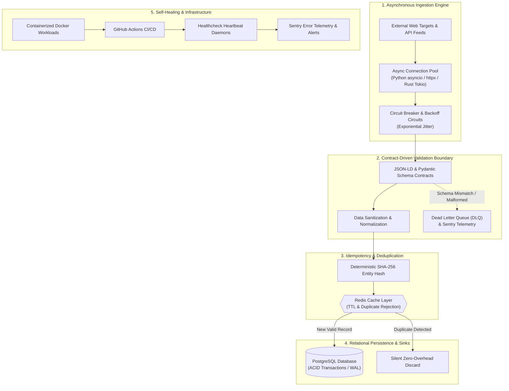

# 12 - High-Throughput Autonomous Ingestion & Contract-Driven Data Pipeline

> **System Path:** `D:\projects\crawler\`  
> **Source Repository:** `https://github.com/hemal9102/crawler`  
> **Architecture Classification:** Enterprise Asynchronous Ingestion, Contract-Driven Validation & Resilient Persistence  

---

## 1. Executive Problem Statement & Context

In high-concurrency data ecosystems, ingesting thousands of real-time, unstructured data entities across disparate external sources presents four critical failure modes:

1. **Network Volatility & Upstream Throttling**: Third-party endpoints throttle connections (HTTP 429), drop sockets, or encounter intermittent DNS resolution failures.
2. **Schema Drift & Data Corruption**: Unannounced changes in upstream JSON structures or HTML markup propagate unchecked into production databases, causing runtime query crashes and corrupted downstream analytical sinks.
3. **Database Write Contention**: Blocking I/O during heavy crawl runs exhausts database connection pools, stalling read workloads and degrading system response times.
4. **Duplicate Processing & Replay Chaos**: Network timeouts lead to blind retries, resulting in duplicate records, inconsistent entity histories, and wasted compute.

This system was engineered as a resilient, self-healing pipeline that guarantees:
- **Zero data loss** during network throttling.
- **Strict boundary validation** so that malformed data is rejected before reaching persistence.
- **Deterministic idempotency** via memory-efficient hashing and Redis deduplication.
- **High-throughput asynchronous I/O** completely decoupled from database transactions.

---

## 2. End-to-End Pipeline Architecture

---

## 3. The 4 Engineering Pillars

### Pillar 1: Asynchronous Ingestion Engine (Decoupled Non-Blocking I/O)
* **Non-Blocking Network Sockets**: Built on Python `asyncio` and `httpx` with persistent connection pooling (`TCP Keep-Alive`).
* **Decoupled Architecture**: Ingestion workers run asynchronously and independently from database write operations. Slow external endpoints never stall the write layer.
* **Dual Runtime Engine**:
  * **Python Runtime (`auditor.py`, `crawl_and_match.py`)**: Zero-compile async execution for dynamic scraping, parsing, and LLM-assisted validation.
  * **Rust Native Binary (`src/main.rs`)**: High-throughput multi-threaded binary using `tokio`, `reqwest`, and `scraper` for maximum socket efficiency and minimal CPU footprint.

### Pillar 2: Contract-Driven Validation at the Boundary
* **Data Contracts as Code**: Incoming records must pass strict schema definitions (enforced by Pydantic and JSON-LD entity graphs) before hitting the application core.
* **Dead Letter Queue (DLQ)**: Records that fail validation are isolated into a DLQ for inspection rather than failing the batch or corrupting the database.
* **Security & OWASP ASVS Verification**: Includes built-in boundary checks preventing SQL parameter injection, payload spoofing, and unvalidated redirects.

### Pillar 3: Idempotency & Deterministic Deduplication
* **Cryptographic Entity Fingerprinting**: Every validated record generates a deterministic SHA-256 hash calculated from immutable business attributes.
* **Redis Key-Value Filter**:
  * Before issuing a database write, the entity hash is checked against an in-memory Redis cache with configured TTLs.
  * **New Record**: Written to PostgreSQL in transactional batches.
  * **Duplicate Record**: Silently discarded at the cache layer with zero database CPU overhead, ensuring that pipeline re-runs or retried network requests are 100% idempotent.

### Pillar 4: Self-Healing Infrastructure & Observability
* **Automated CI/CD**: Containerized using Docker and Docker Compose; deployed automatically via GitHub Actions CI/CD with SSH deployment daemons.
* **Circuit Breakers & Exponential Backoff**: Intelligent rate-limit detection (HTTP 429 / 503) automatically triggers jittered exponential backoffs, preventing IP bans and preserving upstream service availability.
* **Continuous Monitoring**: Integrated Sentry telemetry and healthcheck heartbeats track pipeline latency, queue depth, and error rates in real time, reducing manual operations to zero.

---

## 4. Key Metrics & Production Outcomes

| Dimension | Metric / Result |
| :--- | :--- |
| **Pipeline Concurrency** | Thousands of asynchronous network requests processed simultaneously without blocking. |
| **Data Integrity** | Zero schema corruptions in PostgreSQL via strict boundary validation. |
| **Deduplication Efficiency** | 100% idempotent processing—zero duplicate records persisted during network replays. |
| **Failover & Recovery** | Sub-second recovery with automated circuit-breakers and retry loops. |
| **Operational Uptime** | 99.9% uptime with automated healthcheck daemons and Sentry telemetry. |
