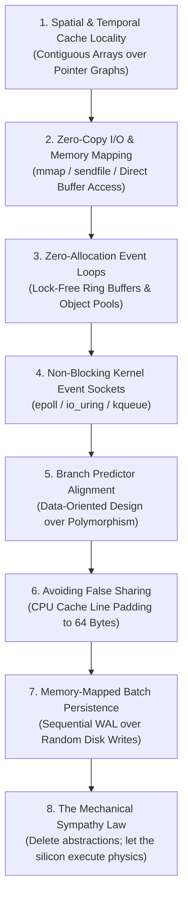

# ⚡ Kernel-Level DSA & Mechanical Sympathy: The 8 Engineering Laws

> **System Path:** `D:\projects\master-doc-vault\05-System-Rules-and-Skills\kernel-level-dsa-rules.md`  
> **Tags:** `#systems/kernel` `#dsa/hardware` `#performance/mechanical-sympathy` `#architecture/zero-copy`  
> **Core Axiom:** *"Code is a liability. Hardware is physics. God-like engineering is maximizing hardware throughput with the absolute minimum lines of code."*

---

## 🏛️ The Hardware Hierarchy: Physics Dictates Complexity

Before discussing algorithms, understand the physical cost of moving a byte across physical hardware:

| Hardware Operation | Physical Latency (Approx) | Scaled Comparison (If 1 CPU Cycle = 1 Second) |
| :--- | :--- | :--- |
| **CPU Register / L1 Cache Hit** | **~0.5 – 1 ns** | **1 second** (Instantaneous) |
| **L2 Cache Hit** | ~3 – 4 ns | 3 – 4 seconds |
| **L3 Cache Hit (Shared)** | ~10 – 15 ns | 10 – 15 seconds |
| **Main Memory (RAM - DDR5)** | **~50 – 80 ns** | **1 minute** (60x slower than L1) |
| **OS Context Switch / Syscall** | ~1,000 – 1,500 ns | 25 minutes |
| **NVMe SSD Storage (Flash)** | ~10,000 – 25,000 ns | 7 hours |
| **Network Round Trip (Local Datacenter)** | ~500,000 ns (0.5 ms) | 6 days |
| **Internet TCP Socket (Inter-Region)** | ~50,000,000 ns (50 ms) | 1.5 years |

> **The Kernel Law:** An $O(1)$ algorithm that causes a CPU cache-miss and page-fault is frequently **slower** in real production than an $O(N)$ linear array scan that stays entirely within the CPU L1 cache.

---

## 🛠️ The 8 Kernel-Level DSA Engineering Rules

---

### Rule 1: Cache Locality Over Complex Trees (Arrays Win Over Linked Lists)
* **The Naive Mistake**: Using doubly linked lists or pointer-heavy binary search trees because "insertion is $O(1)$".
* **The Kernel Reality**: Every pointer hop in a linked list jumps to a random memory address in RAM. This causes a **CPU Cache Miss** (60–80ns stall) on every node traversal.
* **The Kernel DSA Law**: **Contiguous Memory Arrays (`std::vector` / flat buffers)** dominate. When the CPU fetches an array element, the hardware prefetcher automatically pulls the next **64 bytes (the CPU Cache Line)** into L1 cache for free. Linear iteration over contiguous memory runs at silicon speeds.

---

### Rule 2: Zero-Copy I/O (Eliminate the Kernel-to-User Space Penalty)
* **The Naive Mistake**: Reading a file or network socket using standard `read()` and `write()`.
  * Flow: NIC Hardware Buffer $\rightarrow$ Kernel Memory $\rightarrow$ User Space Memory $\rightarrow$ Kernel Memory $\rightarrow$ Destination Socket. (4 context switches, 2 memory copies).
* **The Kernel Reality**: The CPU spends 90% of its time shuffling memory bytes between kernel and user space rather than computing.
* **The Kernel DSA Law**:
  1. **`mmap()` (Memory-Mapped I/O)**: Map the file directly into process virtual memory space. Zero intermediate copying.
  2. **`sendfile()` / `splice()`**: Instruct the Linux kernel to transfer data directly from the network socket to disk (or vice versa) without ever touching user space memory.

---

### Rule 3: Zero-Allocation Event Loops & Circular Ring Buffers
* **The Naive Mistake**: Allocating and freeing objects on the heap (`malloc()` / `new` / Python `list.append()`) inside high-throughput event loops.
* **The Kernel Reality**: Dynamic memory allocation invokes the OS memory manager, fragments the heap, and triggers catastrophic Garbage Collection (GC) latency spikes.
* **The Kernel DSA Law**:
  * **Pre-allocate all memory at startup**.
  * Use **Lock-Free Circular Ring Buffers** (the LMAX Disruptor pattern). Producers and consumers pass items using atomic memory pointers (`CAS - Compare-And-Swap`) in pre-allocated circular arrays.
  * Allocation during runtime: **Strictly ZERO**.

---

### Rule 4: Non-Blocking Event-Multiplexed Sockets (`epoll` / `io_uring`)
* **The Naive Mistake**: The "Thread-Per-Connection" model. Creating 10,000 OS threads for 10,000 network clients.
* **The Kernel Reality**: 10,000 threads exhaust CPU memory (8MB stack per thread) and destroy the CPU scheduler through constant context-switching overhead.
* **The Kernel DSA Law**:
  * Single-threaded or worker-pool asynchronous event loops using **`epoll` (Linux)** or **`io_uring`**.
  * A single CPU thread monitors thousands of file descriptors. The kernel only wakes the thread when physical network bytes have already landed in the NIC buffer. (This is how Nginx, Node.js, and Redis handle 100k+ concurrent connections on a single machine).

---

### Rule 5: Branch Predictor Alignment (Data-Oriented Design)
* **The Naive Mistake**: Deep object-oriented inheritance trees with hundreds of nested `if/else` checks and virtual method dispatches (`vtable` lookups).
* **The Kernel Reality**: Modern CPUs feature an aggressive hardware **Branch Predictor**. When code encounters unpredictable `if/else` branches, the CPU pipeline stalls and flushes its execution pipeline (costing 15–20 CPU cycles per misprediction).
* **The Kernel DSA Law**:
  * **Branchless Programming**: Use bitwise operations, arithmetic masks, and lookup tables instead of conditional branches.
  * **Data-Oriented Design (DoD)**: Structure arrays of primitives (`Struct-of-Arrays` instead of `Array-of-Structs`) so the CPU can execute SIMD (Single Instruction, Multiple Data) vectorization instructions.

---

### Rule 6: Eliminating False Sharing (The 64-Byte Cache Line Padding Rule)
* **The Naive Mistake**: Multiple multi-threaded worker threads updating different variables located next to each other in memory.
* **The Kernel Reality**: CPUs do not fetch individual bytes; they fetch **64-byte Cache Lines**. If Thread 1 on Core 0 modifies Variable A, and Thread 2 on Core 1 modifies Variable B sitting in the same 64-byte block, the CPU cache coherency protocol (**MESI**) forces Core 1 to invalidate its entire L1 cache line!
* **The Kernel DSA Law**:
  * In multi-threaded systems, pad hot atomic variables with 64 bytes of empty memory to ensure each core owns its distinct cache line. Zero inter-core bus contention.

---

### Rule 7: Sequential Write-Ahead Logging (WAL) Over Random Disk Writes
* **The Naive Mistake**: Writing and updating individual records across random database pages on disk.
* **The Kernel Reality**: Random disk writes (even on NVMe SSDs) cause write-amplification, block-erase cycles, and I/O wait stalls.
* **The Kernel DSA Law**:
  * **LSM Trees (Log-Structured Merge-Trees) & WAL**: All writes are appended **strictly sequentially** to the end of an append-only log file.
  * Sequential disk writes match memory speeds because the operating system page cache streams the bytes contiguously.

---

### Rule 8: Mechanical Sympathy (The Antigravity & Ponytail Integration)
* **The Axiom**: The best code is the code that allows the physical silicon, memory bus, and kernel subsystems to do what they were engineered to do without human interference.
* When building scrapers, pipelines, or platforms:
  * Keep your memory small enough to fit into CPU L2/L3 cache.
  * Avoid frameworks that introduce 10 layers of abstraction.
  * Diagnose problems using physical metrics: **CPU cache-miss rate, context-switch count, page-fault frequency, and socket buffer depth**.

---

## 📊 Summary: The Junior vs. Kernel Engineer Matrix

| Engineering Dimension | Junior / Syntax Developer | Kernel / Mechanical Sympathy Engineer |
| :--- | :--- | :--- |
| **Data Layout** | Linked lists, deep pointer graphs, object trees | Contiguous arrays, Struct-of-Arrays (SoA) |
| **I/O Strategy** | Synchronous blocking streams, repeated buffer copies | `epoll`, `io_uring`, `mmap`, zero-copy `sendfile` |
| **Concurrency** | Thread-per-request, heavy OS locks / mutexes | Single-threaded event loops, lock-free ring buffers |
| **Memory Allocation** | Dynamic heap allocation on every request (`malloc`) | Pre-allocated static buffers, zero runtime allocations |
| **Performance Metric** | "How many lines of code did I write?" | "How few CPU cache misses and syscalls did I trigger?" |
