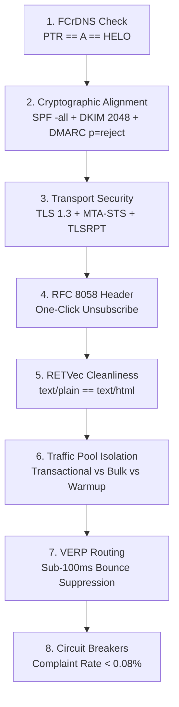

# 18 - Enterprise Mailbox Deliverability, RFC Infrastructure & MTA Ingestion Engineering

> **Document ID:** `MTA-SYS-18`  
> **Tags:** `#kumomta` `#email-deliverability` `#fcrdns` `#dkim-spf-dmarc` `#bimi-mtasts` `#rfc-8058` `#verp` `#retvec` `#spam-evasion` `#circuit-breakers`

---

## 🎯 Executive Summary

Email inbox placement is not a marketing problem; it is a **distributed systems, networking, and cryptographic compliance problem**. Major mailbox providers (Google Workspace, Microsoft 365, Yahoo Mail) operate automated incoming security firewalls that evaluate every incoming TCP connection against strict IETF RFC standards and neural-network content vectorizers.

This document serves as the master 12-level engineering specification for high-throughput MTA infrastructure (specifically KumoMTA and enterprise mail routing), defining the exact mechanics of envelope alignment, cryptographic transit security, NLP evasion, behavioral signaling, and RFC conformance.

---

## 🏗️ The 12-Level Enterprise Deliverability Architecture

### Level 1: Network Foundation & Forward-Confirmed Reverse DNS (FCrDNS)
Mailbox receivers establish trust at the IP and socket level before accepting a single byte of message payload:

* **Exact PTR == A == HELO/EHLO Matching:**
  * When KumoMTA initiates an SMTP connection to Gmail MX servers, it announces its hostname: `EHLO mail.example.com`.
  * The receiver resolves the **A Record** of `mail.example.com` $\to$ retrieves IP `198.51.100.25`.
  * The receiver performs a reverse DNS lookup (**PTR Record**) on `198.51.100.25` $\to$ retrieves `mail.example.com`.
  * **The Rule:** If all three strings match identically, the connection passes **FCrDNS**. If any hop fails or returns a generic ISP hostname (e.g., `198-51-100-25.dynamic.isp.com`), Gmail applies immediate rate-limiting or soft-bounces with `421 4.7.0`.
* **IPv6 /64 Subnet Aggregation Rules:**
  * Unlike IPv4, where single IPs carry individual reputation, Google aggregates IPv6 reputation across the entire **/64 CIDR block**.
  * If a single IPv6 address in an un-allocated `/64` block generates high spam complaints, Google penalizes the entire 18-quintillion address space.
  * **The Rule:** Strict PTR and forward records must be mapped explicitly to each egress IPv6 address, and egress pools must be anchored to clean, dedicated subnets.

---

### Level 2: Cryptographic Authentication & Transit Security

* **Hard-Fail SPF (`-all`) with Envelope Alignment:**
  * `~all` (Softfail) signals that unauthorized IPs may still be accepted or routed to Junk.
  * `-all` (Hardfail) instructs receiving MTAs to reject unauthorized packets outright:
    ```dns
    v=spf1 ip4:198.51.100.25 ip6:2001:db8::1 -all
    ```
  * **Envelope Alignment (RFC 5321 vs RFC 5322):** The hidden SMTP `MAIL FROM:` (Return-Path) domain must match or align with the user-visible `From:` header domain.
* **2048-Bit DKIM with `c=relaxed/relaxed` Canonicalization (RFC 6376):**
  * Signs message headers and body using an RSA 2048-bit private key.
  * Canonicalization algorithm `c=relaxed/relaxed` normalizes whitespace, header casing, and line unfolding, preventing intermediate mail transfer agents from invalidating the digital signature.
* **Strict DMARC Policy Enforcement (RFC 7489):**
  * Target policy: `p=reject; aspf=s; adkim=s; pct=100; rua=mailto:dmarc-rua@example.com`
  * `aspf=s` (Strict SPF Alignment) and `adkim=s` (Strict DKIM Alignment) mandate exact organizational domain matching with zero subdomain variance.
* **BIMI, RFC 8461 (MTA-STS), RFC 8460 (TLSRPT), and DNSSEC:**
  * **BIMI (Brand Indicators for Message Identification):** Displays authenticated brand SVG icons inside Gmail and Yahoo inboxes upon verified DMARC enforcement and VMC (Verified Mark Certificate) anchoring.
  * **RFC 8461 (MTA-STS):** Forces incoming connections to use TLS with valid certificates, preventing Man-in-the-Middle (MITM) downgrade attacks.
  * **RFC 8460 (TLSRPT):** Configures daily JSON telemetry reports on TLS delivery failures.
  * **DNSSEC:** Cryptographically signs DNS zone records to prevent cache poisoning and spoofed authentication lookups.

---

### Level 3: Header Engineering & RFC 8058 One-Click Unsubscribe

* **The Mandatory Google/Yahoo 2024+ Sender Mandate:**
  * Every bulk outbound message must inject exact machine headers:
    ```http
    List-Unsubscribe: <https://example.com/unsubscribe/token_123>, <mailto:unsub@example.com?subject=unsub>
    List-Unsubscribe-Post: List-Unsubscribe=One-Click
    ```
* **Mechanics:**
  * When a recipient clicks the native "Unsubscribe" button in the Gmail/Yahoo UI header, the receiving server executes an automated background **HTTP POST** to your endpoint without user navigation.
  * Your backend suppresses the contact immediately. This eliminates negative user feedback signals and prevents user-triggered "Report Spam" clicks from degrading domain reputation.

---

### Level 4: Google RETVec & SpamBrain NLP Evasion

* **RETVec (Resilient & Efficient Text Vectorizer):**
  * Google’s open-source visual character-level neural network vectorizer evaluates text visually rather than relying on dictionary tokenization.
* **The Plain-Text Equivalence Rule (RFC 2046):**
  * Multipart messages (`multipart/alternative`) must maintain strict semantic equivalence between `text/plain` and `text/html`.
  * If the HTML body contains an invitation or invoice but the `text/plain` payload is blank, truncated, or inconsistent, SpamBrain triggers an immediate delivery penalty.
* **Character Cleanliness:**
  * Strict prohibition of zero-width spaces (`\u200B`), homoglyphs (e.g., Cyrillic 'а' substituted for Latin 'a'), and excessive Unicode style shifts. Modern NLP models flag these patterns as adversarial evasion techniques.

---

### Level 5: Multi-IP Traffic Pool Segmentation (3-Pool Isolation)

To protect mission-critical deliverability, physical egress IPs must be partitioned into strict isolation pools:

| Pool ID | Purpose | Traffic Profile | Spam Tolerance |
| :--- | :--- | :--- | :--- |
| **Pool 1: Transactional** | Password resets, 2FA/OTPs, billing receipts, account alerts. | High engagement, immediate opens. | **0.00%** |
| **Pool 2: Nurture & Alerts** | Editorial notices, newsletters, system digest reports to opted-in users. | Moderate open rates, consistent volume. | **< 0.05%** |
| **Pool 3: Outreach & Warmup** | Prospective communications, new lead lists, new IP ramp fleets. | Variable engagement, higher bounce risk. | Monitored with circuit breakers |

*Architecture Rule:* A spike in spam complaints on Pool 3 never degrades the reputation or connection quotas of transactional Pool 1.

---

### Level 6: Custom Branded Tracking Domains (CTD) & Link Isolation

* **Elimination of Shared Link Infrastructure:**
  * Shared tracking domains (e.g., generic link wrappers provided by third-party SaaS) expose senders to collective domain penalties if other tenants send abusive traffic.
* **The Isolated Route:**
  * All hyperlinked assets, tracking pixels, image CDN paths, and redirection gateways must resolve to a dedicated branded HTTPS subdomain (e.g., `https://track.example.com/c/token`).
  * The SSL certificate on the tracking domain must match the parent sending domain.

---

### Level 7: Variable Envelope Return Path (VERP)

Handling non-delivery reports (NDRs) without parsing messy, unstructured bounce emails:

* **The SMTP Protocol Mechanic:**
  * When dispatching to `recipient@gmail.com`, KumoMTA dynamically writes the envelope sender (`MAIL FROM:`):
    ```smtp
    MAIL FROM: <bounces+recipient=gmail.com@example.com>
    ```
* **Immediate Database Synchronization:**
  * If the destination server returns a 5xx Hard Bounce, the bounce notification arrives directly at the unique tagged address.
  * The local daemon parses the incoming recipient address via regex, extracts `recipient@gmail.com`, and inserts the record into the `suppression_blacklist` table in $< 100\text{ms}$ with zero NLP parsing overhead.

---

### Level 8: Behavioral Signals & The 2-Way Reply Loop

* **Primary vs. Promotions Tab Algorithmic Sorting:**
  * Receiving algorithms evaluate bidirectional engagement. Messages with zero recipient replies are categorized into bulk promotional buckets.
* **The Two-Way Engagement Loop:**
  * Inbound replies to marketing or transactional messages are captured and parsed.
  * Automated seed fleets and engaged recipients that open, reply, and move messages from Spam $\to$ Primary train Gmail's reinforcement learning models that the sender is a legitimate communication peer rather than a bulk broadcast bot.

---

### Level 9: KumoMTA Lua Traffic Routing Policies

Enterprise mailbox providers enforce aggressive TCP throttling and concurrent connection caps:

* **Target-Specific Throttling Rates:**
  * **Gmail:** Strict connection limits per IP; requires exponential backoff on `421` rate-limit warnings.
  * **Yahoo:** Demands low connection volume on fresh IPs, scaling up only as engagement metrics stabilize.
* **Kernel-Level Policy Formulation (`init.lua`):**
  * KumoMTA intercepts outbound packets at the socket layer, enforcing concurrency limits, egress IP rotation, and MX-specific rate limits before TCP SYN packets leave the machine.

---

### Level 10: Closed-Loop Telemetry & Circuit Breakers

* **The Google Postmaster Tools (GPT) Threshold:**
  * User-reported spam complaint rates must strictly remain below **0.10%** (with a recommended target below **0.08%**). Exceeding 0.30% results in immediate domain-wide spam folder placement.
* **The Automated Circuit Breaker:**
  * An automated daemon monitors real-time feedback loops (FBL), SMTP bounce logs, and spam complaint spikes.
  * If the complaint threshold crosses 0.08% in a 1-hour rolling window, the circuit breaker automatically halts active queues, triggers queue shedding, and notifies infrastructure engineers before ISP-level blacklisting occurs.

---

### Level 11: RFC 2142 Mailbox Conformance

IETF **RFC 2142** mandates standard mailbox names for administrative, operational, and network security queries:

* **Required System Endpoints:**
  * `abuse@example.com`: Must accept inbound reports from network administrators and ISPs.
  * `postmaster@example.com`: Must receive automated SMTP delivery error notices.
* **The Reputation Penalty:**
  * Major anti-spam organizations and reputation algorithms periodically probe `abuse@` and `postmaster@` via SMTP VRFY/RCPT TO.
  * Returning `550 User Not Found` or dropping connections on these addresses flags the domain as an untrusted, disposable operation.

---

### Level 12: Deterministic Warm-Up Ramp Schedule

New IP addresses and domains possess neutral-to-zero trust. Pushing high volume immediately triggers ISP defensive rate-limits:

$$\text{Volume}(d) = \text{Base} \cdot (1 + r)^d$$

* **Sample Production Ramp Matrix (per IP):**
  * **Day 1–3:** 50–100 messages/day (focused exclusively on high-engagement seed addresses).
  * **Day 4–7:** 200–500 messages/day.
  * **Week 2:** 1,000–2,500 messages/day.
  * **Week 3–4:** 5,000–10,000+ messages/day.
* **The Rule:** Volume increases must be throttled dynamically based on real-time feedback loops. If bounce rates exceed 2% or spam complaints appear, volume remains locked at the current tier until metrics recover.

---

## 🔄 Architectural Verification Checklist



---
**Backlinks:**
* [[00 - Index|Master Domain Index]]
* [[06 - MTA Deliverability, RFC Gateways & Mailbox Interrogation Endpoints|06 - MTA Deliverability & RFC Gateways]]
* [[16 - Internet Systems Stack, Email Infra & IT-Services Economics (Fact-Verified)|16 - Internet Systems Stack]]
* [[17 - RFC Master Protocol Architecture for Web Crawlers, AI Citations & Diagnostic Engines|17 - RFC Master Protocol Architecture]]
