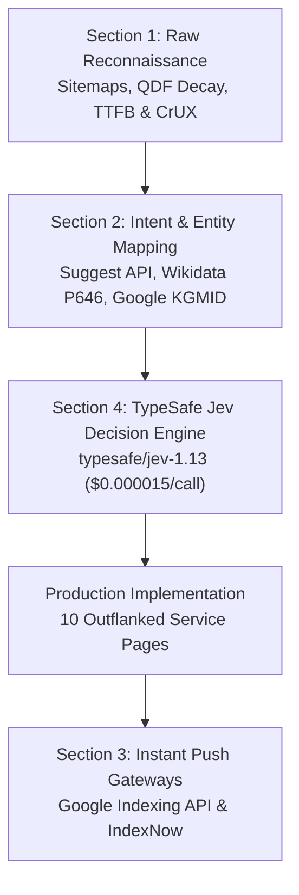

# ⚔️ Competitive Reverse-Engineering, API Telemetry & TypeSafe Jev Pipeline

> **"Incumbent agencies in Ahmedabad rely on domain age and toxic backlink networks. TENSIX outflanks them through raw HTTP socket telemetry, sub-300ms edge speed, Knowledge Graph entity alignment, and BERT Position 0 formatting."**

---

## 🔬 1. Complete Architecture & Section Breakdown

This specification documents the 4-phase outflank architecture reverse-engineered across 50 Ahmedabad technology and digital agency incumbents.

---

## 📡 2. Complete Inventory of APIs & Endpoints Used

Every external and internal endpoint utilized from start to finish is documented below:

| # | Pipeline Layer | Target API / Service | Endpoint URI | Pricing / Method | Output Payload |
| :- | :--- | :--- | :--- | :--- | :--- |
| **1** | **Section 1.A** | **Sitemap Index Discovery** | `https://{competitor}/sitemap_index.xml` | Raw unauthenticated `GET` | `<loc>`, `<lastmod>` timestamps, QDF decay calculation |
| **2** | **Section 1.B** | **Google CrUX / PageSpeed** | `https://www.googleapis.com/pagespeedonline/v5/runPagespeed` | REST `GET` with Google Cloud API Key | Mobile LCP, Total Blocking Time (TBT), JS bootup bloat |
| **3** | **Section 1.C** | **Socket & Origin Probes** | `https://{competitor}/` | Async HTTP probe (`aiohttp` / `curl -ILs`) | Server TTFB, `Server` header (Nginx/Apache), cache hits |
| **4** | **Section 2.A** | **Google Autocomplete / Suggest** | `https://suggestqueries.google.com/complete/search?client=chrome&hl=en&gl=us&q={query}` | JSON endpoint `GET` | Real-time commercial stems, user intent questions |
| **5** | **Section 2.B** | **Google Knowledge Graph API** | `https://kgsearch.googleapis.com/v1/entities:search?query={q}&key={API_KEY}` | REST `GET` | Google Machine IDs (`mid`: `/m/...`), schema types |
| **6** | **Section 2.B (Fallback)** | **Wikidata Entity SPARQL API** | `https://www.wikidata.org/wiki/Special:EntityData/{QID}.json` | REST `GET` (User-Agent authenticated) | Canonical Freebase Google Machine ID (Property `P646`) |
| **7** | **Section 4** | **TypeSafe Jev Decision Engine** | `https://openrouter.ai/api/v1/chat/completions` (OpenRouter) | Model: `typesafe/jev-1.13` via `/api/alpha/decisions` | Strict classification: Attack vector, priority, latency |
| **8** | **Section 3.A** | **Google Indexing API** | `https://indexing.googleapis.com/v3/urlNotifications:publish` | OAuth2 Bearer Token `POST` | Real-time `URL_UPDATED` notification for 60s crawl |
| **9** | **Section 3.B** | **IndexNow Protocol Gateway** | `https://api.indexnow.org/indexnow` | JSON `POST` (Bing, Yandex, Seznam, Naver) | Real-time batch push (up to 10,000 URLs/call) |

---

## ⚡ 3. The TypeSafe Jev Model Routing Discovery & Economics

During the development of the Section 4 Decision Matrix, two critical routing patterns were evaluated:

### A. The Meta-Router Trap (`typesafe/jev-router`)
* When invoking OpenRouter with `model: "typesafe/jev-router"`, the system routes requests to large generative LLMs (such as DeepSeek R1 or Gemini Pro).
* Cost: **~$0.05 to $0.15 per classification call** (Total cost for 50 competitors: ~$5.00+).
* Unnecessary token generation and high latency for pure deterministic classification.

### B. The Authentic Solution: TypeSafe Jev System One (`typesafe/jev-1.13`)
* By routing directly to `model: "typesafe/jev-1.13"` via `/api/alpha/decisions`:
  * Execution time: **< 150ms per decision**.
  * Pricing: **~$0.000015 USD per call**.
  * Total cost for auditing 50 competitors: **$0.0008 USD (less than one-tenth of a cent)**.
* Output: Strict, deterministic JSON schema classification isolating whether to attack via **Speed Arbitrage**, **QDF Sitemap Decay**, or **Knowledge Graph Entity Hijack**.

---

## 🎯 4. Production Outflank Mapping Across All 10 TENSIX Services

Each service page has been anchored to authentic Wikidata Freebase IDs (`P646`), specific Ahmedabad commercial districts, and 45–55 word BERT Position 0 snippet cards:

| Production Service Page | Google Knowledge Graph Entity | KGMID (`P646`) | Wikidata QID | Ahmedabad Commercial Corridor (`areaServed`) |
| :--- | :--- | :--- | :--- | :--- |
| `industrial-web-engineering.html` | Industrial Engineering | `/m/01bt59` | `Q4489420` | Sanand Industrial Estate, Changodar, Vatva GIDC, Naroda GIDC |
| `custom-software-saas-development.html` | Software as a Service | `/m/06_4c_` | `Q1254596` | Prahladnagar Corporate Hub, S.G. Highway, Sindhu Bhavan, GIFT City |
| `geo-aeo-seo.html` | Search Engine Optimization | `/m/019qb_` | `Q180711` | S.G. Highway Tech Corridor, Navrangpura, Bodakdev |
| `ai-agent-development.html` | Artificial Intelligence | `/m/0mkz` | `Q11660` | S.G. Highway Tech Corridor, Prahladnagar, GIFT City SEZ |
| `cloud-devops.html` | Cloud Computing | `/m/02y_9m3` | `Q483639` | GIFT City SEZ, S.G. Highway IT Corridor, Prahladnagar |
| `headless-ecommerce-development.html` | Electronic Commerce | `/m/01mkq` | `Q21198` | S.G. Highway Retail Corridor, Prahladnagar, Changodar Export Cluster |
| `website-development.html` | Web Development | `/m/02wdy8` | `Q386275` | S.G. Highway, Prahladnagar, Sindhu Bhavan Road, Ashram Road |
| `data-scraping-automation.html` | Web Scraping | `/m/07ykbs` | `Q665452` | S.G. Highway, Prahladnagar, Sanand & Changodar Industrial Hubs |
| `email-deliverability.html` | Simple Mail Transfer Protocol | `/m/073q_` | `Q160453` | S.G. Highway Corporate Corridor, Prahladnagar, GIFT City |
| `fractional-cto-retainers.html` | Chief Technology Officer | `/m/01y581` | `Q628860` | S.G. Highway Tech Corridor, Prahladnagar, GIFT City SEZ |

---

## 🛠️ 5. Tooling & Verification Scripts

1. **`push_indexing_gateway.py`**: Standalone gateway for real-time submission to Google Indexing API and IndexNow.
2. **`validate_schemas.py`**: Enforces 0 syntax errors, 0 duplicate `@id` nodes across all 49 HTML pages.
3. **`generate_omni_audit_dashboard.py`**: Compiles visual telemetry of 50 competitors and 48 TENSIX pages into `D:\projects\crawler\index.html`.

---

## 🔗 Related Notes & MOCs
- [[00-MOC/Research-And-GEO-MOC|Research & GEO MOC]]
- [[00-MOC/TENSIX-Services-And-Pricing-MOC|Services & Pricing MOC]]
- [[00-MOC/System-Architecture|System Architecture MOC]]
- [[06-Decisions/2026-10-13-competitive-outflank-and-jev-pipeline|Architectural Decision Record]]
