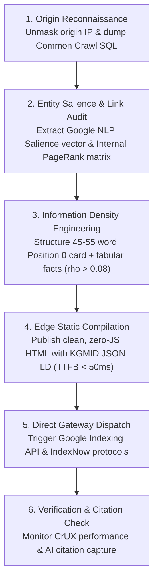

# Competitor Reverse-Engineering & Ranking Outflank Endpoints

> **Path:** `knowledge-vault/04-Research-And-GEO/COMPETITOR_REVERSE_ENGINEERING_AND_RANKING_OUTFLANK.md`  
> **Related Architecture:** [[COMPETITIVE_OUTFLANK_AND_JEV_PIPELINE]], [[HIDDEN_INFRASTRUCTURE_AND_WAYBACK_CDX_SCRAPING]]  
> **Tags:** `#competitor-analysis` `#indexing-gateways` `#sitemaps` `#crux` `#reverse-engineering` `#direct-to-origin` `#pagerank-matrix` `#entity-salience` `#rag-token-economics` `#athena-sql`

---

## 🎯 Executive Summary

Overtaking established corporate competitors does not require multi-thousand dollar SaaS tools (Ahrefs, SEMrush). Modern web infrastructure exposes every competitor's information architecture, performance bottlenecks, schema entities, query gaps, internal link equity distribution, and origin server vulnerabilities through **raw, unauthenticated HTTP endpoints, public ledgers, and telemetry APIs**.

While incumbents rely on client-side proxy cloaking (Cloudflare, Akamai) and bloated keyword-dense copy, systems engineers can:
1. **Unmask true origin IP servers** to measure un-cached compute latency and backend architecture.
2. **Reconstruct their internal PageRank eigenvector matrix** to spot under-linked, vulnerable money pages.
3. **Extract Google NLP Entity Salience vectors** to mathematically identify the exact entity co-occurrences missing from their content.
4. **Outflank generative search engines (GEO/AEO)** by engineering a higher Information-to-Token density ratio ($\rho_{info}$) that wins LLM retrieval-augmented generation (RAG) context windows.
5. **Force instant edge crawling** via direct push gateways in minutes.

---

## 🔬 1. Competitor Extraction Endpoints (Raw Reconnaissance)

### A. Sitemap Index & Freshness Reconnaissance
```http
GET https://competitor.com/robots.txt
GET https://competitor.com/sitemap_index.xml
GET https://competitor.com/sitemap.xml
GET https://competitor.com/wp-sitemap.xml
```

#### The `<lastmod>` Decay Exploit
Inside competitor sitemaps, inspect the `<lastmod>` timestamps:
```xml
<url>
  <loc>https://competitor.com/target-keyword-page</loc>
  <lastmod>2026-08-10T11:20:00Z</lastmod>
</url>
```
* **Vulnerability:** Google’s **QDF (Query Deserved Freshness)** algorithm actively seeks updated entities. If an incumbent has not updated their `<lastmod>` or on-page citations in 6+ months, a fresh edge page published today receives instant algorithmic preference.

---

### B. Core Web Vitals & Render Bottlenecks (Google CrUX API)
```http
GET https://www.googleapis.com/pagespeedonline/v5/runPagespeed?url=https://competitor.com/target-page&strategy=mobile&key={API_KEY}
```

---

### C. Socket & Origin Cache Fingerprinting
```bash
curl.exe -ILs -H "User-Agent: Googlebot/2.1" https://competitor.com/target-page
```

---

### D. Direct-to-Origin Unmasking (Bypassing Cloudflare / Akamai WAF)
```bash
curl -k -v -H "Host: competitor.com" https://198.51.100.24/target-page
```
* Bypasses CDN caching to benchmark true backend database latency, dynamic SSR compute, and unmasked server headers.

---

### E. Common Crawl Columnar SQL Mining (AWS Athena `ccindex`)
```sql
SELECT 
    url, 
    fetch_time, 
    warc_filename, 
    warc_record_offset, 
    content_digest, 
    mime_type
FROM "ccindex"."ccindex"
WHERE url_host_name = 'competitor.com'
  AND subset = 'warc'
  AND mime_type = 'text/html'
ORDER BY fetch_time DESC
LIMIT 5000;
```

---

## 🌪️ 2. Real-Time Search Intent, Entity Salience & Semantic Mapping

### A. Google Autocomplete / Suggest Endpoint
```http
GET https://suggestqueries.google.com/complete/search?client=chrome&hl=en&gl=us&q={competitor_topic}
```

### B. Google Knowledge Graph Search API
```http
GET https://kgsearch.googleapis.com/v1/entities:search?query={topic}&key={API_KEY}&limit=10&indent=True
```

### C. Google Cloud Natural Language API (`analyzeEntities`)
```http
POST https://language.googleapis.com/v1/documents:analyzeEntities?key={GOOGLE_NLP_KEY}
Content-Type: application/json

{
  "document": {
    "type": "PLAIN_TEXT",
    "content": "Raw extracted text from competitor target page..."
  },
  "encodingType": "UTF8"
}
```
* Extracts entity salience scores ($S_i \in [0, 1]$) and maps the **Topical Entity Delta** $\Delta_{\text{entities}} = \mathbf{E}_{\text{corpus}} \setminus \mathbf{E}_{\text{competitor}}$.

---

## 🕸️ 3. Structural Link Equity & Internal PageRank Matrix Extraction

Construct the stochastic transition matrix $M$ from the competitor's internal link graph and compute the steady-state PageRank eigenvector:
$$\mathbf{R} = \left(\frac{1 - d}{N}\right)\mathbf{1} + d \cdot M^T \mathbf{R}$$

* Identifies **Vulnerable Orphan Pages** (money pages with low internal link equity ranking solely on domain age) that can be overtaken quickly.

---

## 🤖 4. Generative Search (GEO/AEO) & RAG Token Density Economics

$$\rho_{info} = \frac{\text{Verifiable Facts + Schema Entities + Empirical Metrics}}{\text{Total Context Tokens}}$$

* Dense markdown fact cards ($\rho_{info} \approx 0.095$) fit cleanly into LLM context window budgets and defeat bloated traditional SEO articles ($\rho_{info} \approx 0.005$) during vector cosine similarity retrieval in Perplexity and Google AIO.

---

## ⚡ 5. The Instant Indexing & Push Gateways

* **Google Indexing API**: `POST https://indexing.googleapis.com/v3/urlNotifications:publish`
* **IndexNow Protocol**: `POST https://api.indexnow.org/indexnow`
* **WebSub**: `POST https://pubsubhubbub.appspot.com/`

---

## 🔄 6. The Industrial 6-Step Competitive Outflank Loop


