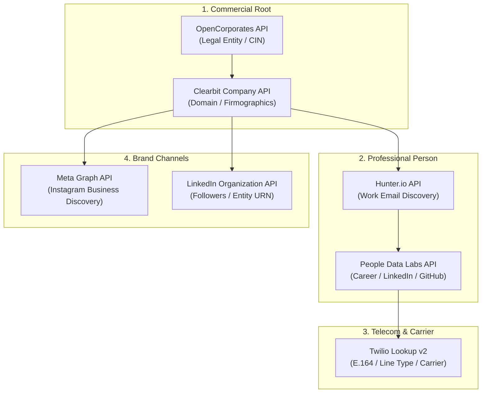

# Entity Resolution, Identity Graph & Cross-Platform Intelligence Endpoints

> **Path:** `knowledge-vault/04-Research-And-GEO/ENTITY_RESOLUTION_AND_IDENTITY_GRAPH_ENDPOINTS.md`  
> **Related Architecture:** [[COMPETITIVE_OUTFLANK_AND_JEV_PIPELINE]], [[MTA_SERVICE_ENDPOINTS_AND_RFC_TELEMETRY]]  
> **Tags:** `#entity-resolution` `#identity-graph` `#b2b-enrichment` `#cross-platform` `#telemetry-endpoints` `#e164-validation`

---

## 🎯 Executive Summary

Cross-platform intelligence requires bridging fragmented data nodes across disparate digital ecosystems: **domain names, registered corporate entities, professional identities (LinkedIn), corporate email infrastructure, phone/mobile carriers (E.164), and brand social presences (Instagram)**.

In modern data engineering, connecting these disparate signals is achieved through **Entity Resolution Pipelines** operating on an **Identity Graph (ID Graph)**. Rather than relying on closed data silos, systems engineers query programmatic REST gateways, DNS-over-HTTPS registries, carrier HLR gateways, and developer graph APIs to stitch a deterministic, 360-degree intelligence record.

---

## 🏢 1. Company & Legal Entity Resolution Endpoints

### A. OpenCorporates REST API (Global Legal Entity Registry)
```http
GET https://api.opencorporates.com/v0.4/companies/search?q={company_name}&jurisdiction_code=in
Authorization: Bearer {OPENCORPORATES_API_KEY}
```
* *Returns:* Legal company name, registration number (CIN), incorporation date, registered address, and active directors.

### B. Clearbit / HubSpot Company Enrichment API
```http
GET https://company.clearbit.com/v2/companies/find?domain={domain}
Authorization: Bearer {CLEARBIT_API_KEY}
```
* *Returns:* Firmographics, employee headcount, annual revenue, tech stack, and official social handles.

---

## 👤 2. Professional & Identity Graph APIs (B2B Person Graph)

### A. People Data Labs (PDL) Person Enrichment API
```http
GET https://api.peopledatalabs.com/v1/person/enrich?email={work_email}&api_key={PDL_API_KEY}
```
* *Returns:* Full name, job title, company entity, education, verified LinkedIn URL, GitHub profile, and work mobile.

### B. Apollo.io B2B People Match API
```http
POST https://api.apollo.io/v1/people/match
Content-Type: application/json

{
  "api_key": "{APOLLO_API_KEY}",
  "first_name": "Hemal",
  "organization_name": "Tensix",
  "domain": "tensix.in"
}
```

---

## ✉️ 3. Corporate Email Discovery & Verification Gateways

### A. Hunter.io Email Finder API
```http
GET https://api.hunter.io/v2/email-finder?domain={domain}&first_name={first_name}&last_name={last_name}&api_key={HUNTER_API_KEY}
```
* *Returns:* Direct work email, deliverability confidence score (`0-100`), and public source URLs.

### B. ZeroBounce Verification Endpoint
```http
GET https://api.zerobounce.net/v2/validate?api_key={ZEROBOUNCE_API_KEY}&email={email}&ip_address=
```
* *Returns:* Live SMTP mailbox verification (`valid`, `invalid`, `catch-all`).

---

## 📱 4. Mobile & Carrier Intelligence Endpoints (E.164)

### A. Twilio Lookup API v2 (Carrier & Line Type Intelligence)
```http
GET https://lookups.twilio.com/v2/PhoneNumbers/+919876543210?Fields=line_type_intelligence,caller_name
Authorization: Basic {ACCOUNT_SID}:{AUTH_TOKEN}
```
* *Returns:* E.164 format, carrier name (Jio, Airtel, Vodafone), line type (`mobile`, `landline`, `voip`), and CNAM registered caller identity.

### B. Numverify E.164 Validation API
```http
GET http://apilayer.net/api/validate?access_key={NUMVERIFY_API_KEY}&number=+919876543210&country_code=IN&format=1
```

---

## 📸 5. Brand Social Graph & Cross-Platform Discovery

### A. Meta Graph API — Instagram Business Discovery
```http
GET https://graph.facebook.com/v19.0/{INSTAGRAM_BUSINESS_ACCOUNT_ID}?fields=business_discovery.username({brand_handle}){id,username,name,biography,website,followers_count,media_count}&access_token={META_GRAPH_ACCESS_TOKEN}
```
* *Returns:* Verified bio link, contact buttons (public email/phone), and post engagement metrics.

### B. LinkedIn Organization API
```http
GET https://api.linkedin.com/v2/organizations?q=vanityName&vanityName=tensix
Authorization: Bearer {LINKEDIN_OAUTH_TOKEN}
```
* *Returns:* Entity URN, headquarters, employee count, and company updates.

---

## 🔄 6. The Unified Graph-Stitching Pipeline



---

## ⚖️ 7. Compliance & Privacy Boundaries

1. **B2B Legitimate Interest:** Corporate email addresses and professional public profiles fall under commercial business outreach provisions (EU GDPR Art. 6(1)(f), US CAN-SPAM).
2. **India DPDP Act (2023):** Personal consumer identifiable information requires explicit consent from the data principal.
3. **Anti-Scraping Policies:** Always utilize authorized developer Graph APIs or certified data providers to avoid platform suspensions.
