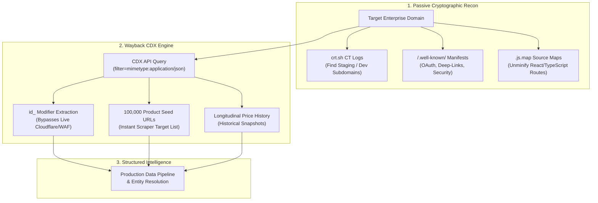

# Hidden Infrastructure Reconnaissance, Google Dorking & Wayback CDX Scraping

> **Path:** `knowledge-vault/04-Research-And-GEO/HIDDEN_INFRASTRUCTURE_AND_WAYBACK_CDX_SCRAPING.md`  
> **Related Architecture:** [[COMPETITIVE_OUTFLANK_AND_JEV_PIPELINE]], [[ENTITY_RESOLUTION_AND_IDENTITY_GRAPH_ENDPOINTS]]  
> **Tags:** `#reconnaissance` `#certificate-transparency` `#google-dorking` `#wayback-cdx` `#data-scraping` `#osint` `#source-maps`

---

## 🎯 Executive Summary

The modern web is built on layers of cryptographic ledgers, historical crawler archives, mobile interoperability manifests, and public routing tables. While corporate targets invest heavily in client-side anti-bot platforms (Cloudflare Turnstile, DataDome, Akamai), their infrastructure, staging environments, internal APIs, and catalog data remain permanently exposed across **unindexed, public telemetry protocols**.

By querying Certificate Transparency logs, interrogating the Wayback Machine CDX index, extracting client-side source maps, and applying targeted search operators, systems engineers can discover hidden API endpoints, bypass anti-bot shields without rotating proxies, and harvest millions of structured catalog records in minutes.

---

## 🔬 PART 1: The Hidden Infrastructure Reconnaissance Layers

### 1. Certificate Transparency (CT) Logs (RFC 6962)
* **What it is:** Public, append-only cryptographic ledgers recording every SSL certificate issued globally.
* **Interrogation Endpoint:**
  ```http
  GET https://crt.sh/?q=%.tensix.in&output=json
  ```
* **Real-Time Streaming:** WebSocket feed at `wss://certstream.calidog.io/` streaming all issued certificates in real time.

### 2. Historical Route & URL Mining (Wayback Machine CDX API)
* **What it is:** Raw index of every URL, API endpoint, and parameter queried over 25+ years.
* **Interrogation Endpoint:**
  ```http
  GET http://web.archive.org/cdx/search/cdx?url=*.target.com/*&output=json&fl=original&collapse=urlkey
  ```

### 3. Client-Side Source Maps (`.js.map` Leakage)
* **The Exposure:** Build pipelines deploying `.map` files to public edge CDNs.
* **Extraction:** Appending `.map` to any frontend bundle URL (`https://target.com/static/js/main.chunk.js.map`).
* **Tool:** `reverse-sourcemap` reconstructs the original unminified TypeScript/React project.

### 4. RFC Well-Known & Mobile Deep-Link Manifests
* **OpenID / OAuth2 Auto-Discovery:** `GET /.well-known/openid-configuration`
* **Android Assetlinks:** `GET /.well-known/assetlinks.json` (Exposes package names & SHA256 cert fingerprints).
* **Apple Universal Links:** `GET /.well-known/apple-app-site-association` (Exposes Apple Team IDs & internal app paths).
* **Security RFC 9116:** `GET /.well-known/security.txt`

### 5. Advanced Search Operators ("Google Dorking")
* **Interactive Swagger / OpenAPI Specs:** `site:target.com inurl:swagger-ui | inurl:api-docs | filetype:json inurl:openapi`
* **Open Directory Listings:** `site:target.com intitle:"Index of /" | intitle:"Index of /uploads"`
* **Staging / Subdomain Filtering:** `site:*.target.com -www.target.com -target.com`
* **Cloud Storage References:** `site:s3.amazonaws.com "target.com"`

### 6. BGP & ASN Mapping
* Maps all CIDR netblocks owned by an organization via `https://bgp.he.net/AS{ASN}` and `https://stat.ripe.net`.

### 7. DNS Wildcards & Zone Transfer (AXFR) Residuals
* Querying RFC 2782 service records reveals internal cluster services over DoH:
  `GET https://dns.google/resolve?name=_sip._tcp.target.com&type=SRV`

---

## ⚡ PART 2: Weaponizing Wayback CDX for High-Throughput Data Scraping

### 1. The `id_` Modifier: Bypassing Anti-Bot Walls via Archive
* **Raw byte-for-byte HTML/JSON (No Wayback banner injection):**
  `https://web.archive.org/web/{timestamp}id_/{target_url}`
* **Benefit:** Scrapes Internet Archive CDN directly, avoiding target origin WAFs and bot challenges.

### 2. Hunting for Hidden JSON APIs
```http
GET http://web.archive.org/cdx/search/cdx?url=*.target.com/*&output=json&filter=mimetype:application/json&filter=statuscode:200&collapse=urlkey&limit=500
```
* Returns structured JSON payloads without writing HTML DOM parsers.

### 3. Extracting 100,000 Catalog URLs Without a Spider
```http
GET http://web.archive.org/cdx/search/cdx?url=target.com/product/*&output=json&fl=original&collapse=urlkey&filter=statuscode:200
```
* Delivers complete catalog seed lists in seconds.

### 4. Hunting for Leaked Data Files
```http
GET http://web.archive.org/cdx/search/cdx?url=*.target.com/*&output=json&fl=original&filter=original:.*\.(csv|xlsx|json|tsv)$&collapse=urlkey
```

### 5. Time-Series Scraping (Historical Price Tracking)
* Extracts snapshots across years to construct historical pricing curves.

---

## 🗺️ Topology Diagram


