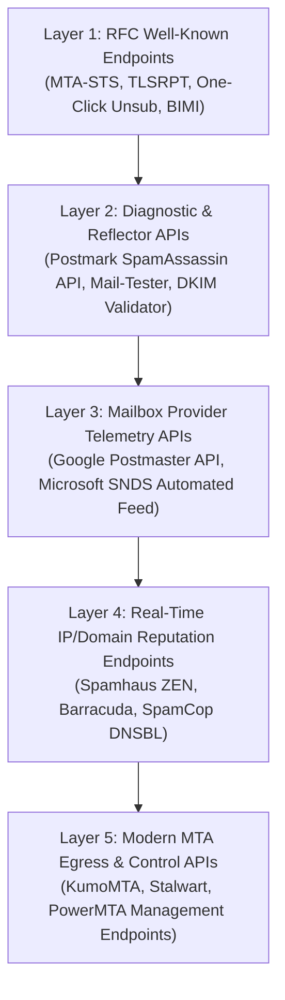

# 📬 MTA Service Endpoints, Automated Diagnostic APIs & RFC Telemetry

> **"Just as web crawlers expose sitemaps, TTFB, and CrUX telemetry through raw HTTP endpoints, modern Mail Transfer Agents (MTAs) and receiver algorithms (Google SpamNet, Microsoft SmartScreen) expose reputation feeds, RFC compliance endpoints, and diagnostic APIs."**

---

## 🏛️ 1. Architecture Overview: The 5 Layers of MTA Endpoints



---

## 🌐 Layer 1: RFC-Mandated Public Web & DNS Endpoints

These are public endpoints that every enterprise sending domain must serve or consume according to modern IETF RFCs and 2024+ Google/Yahoo enforcement policies:

### A. MTA-STS Policy Endpoint (RFC 8461)
Forces TLS encryption and drops man-in-the-middle (MITM) downgrade attacks from sending MTAs.

```http
GET https://mta-sts.{yourdomain}/.well-known/mta-sts.txt
```
* **DNS Anchor**: TXT `_mta-sts.{yourdomain}` → `v=STSv1; id=2026101301`
* **Response Body (`text/plain`)**:
  ```text
  version: STSv1
  mode: enforce
  mx: mail.yourdomain.com
  max_age: 604800
  ```

### B. SMTP TLS Reporting (TLSRPT) Ingestion Endpoint (RFC 8460)
Receives automated JSON reports from Google and Microsoft when TLS negotiation fails.

* **DNS Anchor**: TXT `_smtp._tls.{yourdomain}` → `v=TLSRPTv1; rua=https://yourdomain.com/api/v1/tls-reports,mailto:tlsrpt@yourdomain.com`
* **Inbound HTTP Payload (Sent by Google/Microsoft MTAs via POST)**:
  ```json
  {
    "organization-name": "Google Inc.",
    "date-range": { "start-datetime": "2026-10-12T00:00:00Z", "end-datetime": "2026-10-12T23:59:59Z" },
    "contact-info": "smtp-tls-reporting@google.com",
    "report-id": "2026-10-12-google-tls-report",
    "policies": [{
      "policy": { "policy-type": "sts", "policy-string": ["version: STSv1", "mode: enforce"], "policy-domain": "yourdomain.com" },
      "summary": { "total-successful-session-count": 14200, "total-failure-session-count": 0 }
    }]
  }
  ```

### C. One-Click List-Unsubscribe Endpoint (RFC 8058 / Gmail Mandate)
Required by Google and Yahoo for all commercial senders. When a recipient clicks "Unsubscribe" inside Gmail's UI, Google sends an automated HTTP `POST` to this endpoint.

* **MIME Headers Injected by Sender MTA**:
  ```http
  List-Unsubscribe: <https://yourdomain.com/api/v1/unsub?token=abc123xyz>, <mailto:unsub@yourdomain.com?subject=unsub>
  List-Unsubscribe-Post: List-Unsubscribe=One-Click
  ```
* **Payload Dispatched by Googlebot/Gmail Client**:
  ```http
  POST https://yourdomain.com/api/v1/unsub?token=abc123xyz HTTP/1.1
  Host: yourdomain.com
  Content-Type: application/x-www-form-urlencoded

  List-Unsubscribe=One-Click
  ```

### D. BIMI Logo & VMC Certificate Endpoints (RFC 9460 Draft)
* **DNS Anchor**: TXT `default._bimi.{yourdomain}` → `v=BIMI1; l=https://yourdomain.com/assets/bimi-logo.svg; a=https://yourdomain.com/assets/bimi-cert.pem`

---

## 🔬 Layer 2: Free Automated Diagnostic & SpamAssassin APIs

Before dispatching an email campaign through your MTA, you can test the raw RFC 5322 MIME string against live classification engines without setting up your own SpamAssassin daemon:

### A. Postmark SpamCheck API (Free, Unauthenticated REST Endpoint)
Takes any raw email (headers + body) and returns the exact numerical SpamAssassin score and every rule triggered.

* **Endpoint**: `https://spamcheck.postmarkapp.com/filter`
* **Method**: `POST`
* **Request**:
  ```json
  {
    "email": "From: hemal@tensix.in\r\nTo: user@example.com\r\nSubject: Systems Engineering\r\n\r\nHello...",
    "options": "long"
  }
  ```
* **Response**:
  ```json
  {
    "success": true,
    "score": "0.1",
    "rules": [
      { "points": "0.0", "name": "SPF_PASS", "description": "SPF: sender matches SPF record" },
      { "points": "0.1", "name": "DKIM_SIGNED", "description": "Message has a DKIM signature" },
      { "points": "0.0", "name": "HTML_MESSAGE", "description": "HTML included in message" }
    ]
  }
  ```

### B. Mail-Tester Webhook Diagnostics
* Query string endpoint: `https://www.mail-tester.com/{alias}&format=json`

---

## 📊 Layer 3: Mailbox Provider Telemetry APIs

The two largest consumer and enterprise receivers (Google and Microsoft) maintain automated telemetry feeds for high-volume senders:

### A. Google Postmaster Tools API
Programmatically pulls domain and IP reputation directly from Google SpamNet.

* **Base URL**: `https://postmastertools.googleapis.com/v1/`
* **Auth**: OAuth2 Bearer Token (Scope: `https://www.googleapis.com/auth/postmaster.readonly`)
* **Endpoint**:
  ```http
  GET https://postmastertools.googleapis.com/v1/domains/{domain_name}/trafficStats
  ```
* **Telemetry Returned**:
  * `userReportedSpamRatio`: Real-time user complaint percentage (must remain `< 0.10%` to prevent spam folder placement).
  * `ipReputation`: `HIGH`, `MEDIUM`, `LOW`, `BAD`.
  * `domainReputation`: `HIGH`, `MEDIUM`, `LOW`, `BAD`.
  * `spfSuccessRatio`, `dkimSuccessRatio`, `dmarcSuccessRatio`.
  * `deliveryErrors`: Breakdown of rate limits, bad MX, and authentication drops.

### B. Microsoft SmartNetwork Data Services (SNDS) Automated Feed
Microsoft provides a raw, secret-key authenticated endpoint that exports daily IP reputation and Spam trap hits across all Outlook, Hotmail, and Live.com traffic.

* **Endpoint**:
  ```http
  GET https://sendersupport.olc.protection.outlook.com/snds/data.aspx?key={YOUR_AUTOMATED_DATA_FEED_KEY}
  ```
* **Output Format (`text/tab-separated-values`)**:
  ```tsv
  IP Address    Activity Date    Messages    Filter Result    Complaint Rate    Trap Hits    Sample HELO
  192.0.2.1     10/12/2026       1,450       GREEN            < 0.1%            0            mail.tensix.in
  192.0.2.2     10/12/2026       4,200       YELLOW           0.4%              1            mail.tensix.in
  ```

---

## 🛡️ Layer 4: Real-Time IP/Domain Reputation Endpoints (DNSBL Probes)

Before binding an IP in your MTA, query global DNSBL endpoints via fast reverse-DNS lookups:

```python
import socket

def check_ip_reputation(ip):
    reversed_ip = ".".join(reversed(ip.split(".")))
    blocklists = [
        "zen.spamhaus.org",       # SBL, XBL, PBL
        "b.barracudacentral.org", # Barracuda Reputation
        "bl.spamcop.net",         # SpamCop Complaints
        "dnsbl.sorbs.net"         # SORBS
    ]
    for bl in blocklists:
        query = f"{reversed_ip}.{bl}"
        try:
            res = socket.gethostbyname(query)
            print(f"[LISTED] {ip} on {bl} -> Return code: {res}")
        except socket.gaierror:
            print(f"[CLEAN] {ip} on {bl}")
```

* **Spamhaus Return Codes (`zen.spamhaus.org`)**:
  * `127.0.0.2` = SBL (Spamhaus Block List - verified spam source)
  * `127.0.0.4` = XBL (Exploits Block List - infected zombie/proxy)
  * `127.0.0.10` / `127.0.0.11` = PBL (Policy Block List - residential range, must not run direct MTA)

---

## ⚙️ Layer 5: Modern MTA Egress & Control APIs (KumoMTA & Stalwart)

When deploying modern Rust-based or C-based MTAs, control is maintained via local HTTP microservice endpoints rather than modifying legacy config files:

### KumoMTA Management Endpoints (`localhost:8000`)
KumoMTA exposes an embedded HTTP listener for programmatic traffic shaping:

* `GET /api/admin/metrics.json`: Live queue metrics, memory footprint, socket counts.
* `POST /api/admin/suspend`: Instantly suspends outbound traffic to a specific MX (e.g. `gmail.com`) when rate limits (421) are detected.
* `POST /api/admin/rebind`: Reassigns queued messages from a flagged IP to a clean standby IP pool dynamically.
* `GET /api/admin/status`: Uptime, thread count, and queue depths.

### Dynamic Lua Hooks (`init.lua` in KumoMTA)
```lua
local kumo = require 'kumo'

kumo.on('smtp_server_message_received', function(msg)
  -- 1. Check SpamAssassin endpoint dynamically
  -- 2. Inspect RFC 8058 List-Unsubscribe presence
  -- 3. Reject or queue based on recipient domain
end)
```

---

## 🎯 Summary Checklist for Outflanking Enterprise Deliverability

1. **Serve `/.well-known/mta-sts.txt`** via HTTPS with valid TLS on port 443.
2. **Expose RFC 8058 `List-Unsubscribe` POST endpoint** to handle one-click unsubscribe webhooks.
3. **Automate Google Postmaster Tools API** to monitor real-time complaint rate `< 0.10%`.
4. **Run Pre-Flight SpamAssassin Scans** via Postmark's free endpoint before dispatching batches.
5. **Monitor DNSBL IP Health** (Spamhaus ZEN, Barracuda) programmatically every 6 hours.
