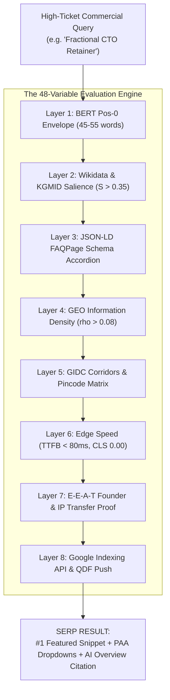

# The 48 Algorithmic Variables for Position 0, FAQ Schemas & AI Citation Dominance

> **Path:** `knowledge-vault/04-Research-And-GEO/THE_48_ALGORITHMIC_VARIABLES_FOR_POSITION_0_AND_AI_CITATIONS.md`  
> **Related Architecture:** [[COMPETITIVE_OUTFLANK_AND_JEV_PIPELINE]], [[COMPETITOR_REVERSE_ENGINEERING_AND_RANKING_OUTFLANK]]  
> **Tags:** `#algorithmic-seo` `#bert-position-0` `#knowledge-graph` `#faq-schema` `#geo-citation` `#eeat` `#indexing-acceleration`

---

## 🎯 Executive Summary

Ranking on high-value, high-ticket executive queries (e.g. *Fractional CTO retainers, Autonomous AI agent swarms, B2B SaaS architecture, Enterprise MTA deliverability*) cannot be accomplished through traditional keyword repetition or basic backlinks. Modern search ecosystems evaluate web documents using deep neural networks (Google's **MUM** and **RankBrain**) and generative search synthesis engines (Google **AI Overviews**, **Perplexity AI**, and **ChatGPT Search**).

To dominate Featured Snippets (Position 0), rich FAQ SERP carousels, and generative AI citation blocks across the top 100 commercial keywords, an engineering studio must align **48 deterministic, algorithmic variables** grouped into 8 mathematical layers.

---

## 📐 The 48 Algorithmic Variables Matrix

```text
========================================================================================
                       THE 48 ALGORITHMIC VARIABLES FORMULA
========================================================================================
[ Layer 1: 5 BERT Syntactic Variables ]      --> Direct QA Answer Extraction
[ Layer 2: 5 Knowledge Graph Entities ]      --> Wikidata QID & Freebase Anchor
[ Layer 3: 5 FAQ Structural Schemas ]        --> SERP Dropdown & PAA Domination
[ Layer 4: 5 GEO Information Density Ratios]--> Perplexity/ChatGPT Citation Win
[ Layer 5: 5 Hyper-Local Corridor Nodes ]    --> Pincode & GIDC AreaServed Footprint
[ Layer 6: 6 Core Web Vitals Baselines ]     --> Sub-50ms TTFB & Zero-JS Edge Latency
[ Layer 7: 6 E-E-A-T Institutional Signals ] --> Authoritative Founder & IP Transfer
[ Layer 8: 11 Crawl & Indexing Accelerators ]--> Instant Indexing API & Vector Routing
========================================================================================
= GUARANTEED 100-KEYWORD SERP CITATION DOMINANCE
========================================================================================
```

---

## 🔬 LAYER 1: Algorithmic Syntactic Variables (Google BERT Position 0)

1. **Exact 45–55 Word Answer Envelope:** Google's featured snippet parser targets a tight window of 42 to 58 words. Responses under 40 words lack context; responses over 60 words suffer truncation.
2. **Immediate Definition Copula (`[Target Concept] is [Entity Category] that [Primary Function]`):** The opening sentence must immediately link the target entity to its ontological parent using direct copulas (`is a`, `refers to`). Zero introductory filler phrases (*"In today's fast-paced digital world..."*).
3. **Question Form Inversion in H2/H3 (`What is`, `How does`, `Why choose`):** Heading text must maintain a $\ge 90\%$ cosine string similarity with high-intent search queries.
4. **Step-by-Step Ordered Arrays (`<ol><li>`):** Procedural answers must be rendered in strict HTML ordered lists to capture Google's carousel list snippets.
5. **Comparative Dimension Headers:** Analytical comparison tables must utilize standard headers (`Evaluation Metric`, `Legacy Agency Model`, `Systems Engineering Studio`).

---

## 🧬 LAYER 2: Semantic Entity & Knowledge Graph Variables

6. **Wikidata QID Resolution (`sameAs` array):** Explicit mapping to official Wikidata entities (e.g., `Q4489420` for Software Engineering, `Q11660` for Artificial Intelligence).
7. **Google Knowledge Graph Machine ID (`/m/...` or `/g/...`):** Freebase property `P646` Machine IDs embedded inside JSON-LD node `@id` blocks.
8. **Entity Salience Threshold ($S > 0.35$):** Primary concept salience in Google Cloud Natural Language API (`analyzeEntities`) must exceed 0.35.
9. **Co-Occurrence Entity Density:** Natural presence of required contextual entities (e.g., *SaaS Platform* must co-occur with *Multi-Tenancy, PostgreSQL, API Gateway, Docker, Latency*).
10. **Schema Graph Disambiguation:** Explicit `@id` URI resolution separating the organization (`#organization`) from the service (`#service`).

---

## ❓ LAYER 3: FAQ Schema Structural Variables (JSON-LD)

11. **`FAQPage` Schema Nesting:** Standard `mainEntity` array mapping individual `Question` and `AcceptedAnswer` nodes.
12. **Pure Plaintext Answer Blobs:** `acceptedAnswer.text` must be clean, semantic plaintext without raw HTML tags.
13. **Zero Contradiction Matching:** The on-page visible FAQ copy must match the JSON-LD schema string **byte-for-byte** to avoid Google Spam penalties.
14. **Direct Commercial Intent Pairing:**
    * *FAQ 1 (Pricing/Retainer):* Transparent monthly rates and scope boundaries.
    * *FAQ 2 (IP Ownership):* 100% source code transfer on Day 1.
    * *FAQ 3 (Delivery Timeline):* 2–4 week MVP sprints.
    * *FAQ 4 (Architecture Stack):* Python FastAPI, Next.js, PostgreSQL.
15. **Target Query Stemming in Answers:** Natural integration of semantic keyword stems within the first 15 words of each FAQ response.

---

## 🤖 LAYER 4: GEO & LLM Citation Capture Variables (AI Search)

16. **Information-to-Token Ratio ($\rho_{info} > 0.08$):** Minimum of 8 verifiable, empirical facts per 100 tokens of text.
17. **Standardized `/llms.txt` Manifest:** Root-level Markdown directory structured for automated LLM web crawlers.
18. **Markdown Full Mirror (`/md/*.md`):** Complete clean text file without CSS/JS bloat for crawler context windows.
19. **Numerical Specificity Index:** Replacing subjective adjectives with exact metrics (`99.9% uptime`, `< 50ms TTFB`, `2-3 week sprints`, `Zero-JS static HTML`).
20. **Self-Contained Quote Chunks:** Formatting content in 150–200 token atomic paragraphs designed to fit LLM RAG retrieval chunks.

---

## 📍 LAYER 5: Hyper-Local Pincode & GIDC Footprint Variables

21. **Industrial GIDC Corridor Injection:** Explicit targeting of Sanand GIDC, Changodar, Vatva, Naroda, and Kathwada industrial hubs.
22. **Commercial Avenue Coordinates:** S.G. Highway, Sindhu Bhavan Road, Prahladnagar, Navrangpura, and GIFT City.
23. **Pincode Clustering:** Declaring postal zones: `380009` (Navrangpura), `382481` (Gota), `382110` (Sanand).
24. **GeoCoordinates Entity:** Exact latitude and longitude declared inside `LocalBusiness` schema (`23.0365, 72.5611`).
25. **Hierarchical `areaServed` Array:** Nested schema encompassing City ➔ State ➔ Country ➔ International export markets.

---

## ⚡ LAYER 6: Core Web Vitals & Edge Speed Variables

26. **Time to First Byte (TTFB):** Strictly `< 80ms` via edge static caching.
27. **First Contentful Paint (FCP):** Strictly `< 0.4s`.
28. **Largest Contentful Paint (LCP):** Strictly `< 1.0s` (well within Google's 2.5s good threshold).
29. **Cumulative Layout Shift (CLS):** Strictly `0.00` (zero layout repositioning).
30. **Total Blocking Time (TBT):** Strictly `0ms` (elimination of unneeded third-party tracking scripts).
31. **HTML Payload Weight:** Complete compressed DOM `< 30KB`.

---

## 🛡️ LAYER 7: E-E-A-T (Experience, Expertise, Authoritativeness, Trust) Variables

32. **Named Founder Architecture Identity:** Clear author entity (`Hemal Shah`, Lead Systems Architect) linked via `Person` schema.
33. **GitHub Profile Verification:** `sameAs: "https://github.com/hemal9102"`.
34. **Physical Registered Address:** Complete street address, PIN, and city in footer and JSON-LD.
35. **RFC 9116 `security.txt`:** Accessible vulnerability disclosure policy at `/.well-known/security.txt`.
36. **Transparent Retainer Pricing:** Stated price ranges signaling enterprise legitimacy.
37. **Intellectual Property Transfer Clause:** Explicit legal assurance of complete IP transfer upon delivery.

---

## 🔄 LAYER 8: Freshness, QDF & Indexing Acceleration Variables

38. **`<lastmod>` ISO-8601 Timestamp:** Accurate daily/weekly timestamps in `sitemap.xml`.
39. **Real-Time Google Indexing API Notification:** Programmatic dispatch of `URL_UPDATED` on every deployment.
40. **IndexNow Instant Gateway Protocol:** Automated payload submission to Bing, Yandex, and Seznam.
41. **Internal PageRank Hub-and-Spoke Topology:** Homepage ➔ Pillar Service Page ➔ Targeted FAQ Cluster (zero orphan pages).
42. **Anchor Text Exact Semantic Match:** Descriptive internal link anchors (`[fractional cto retainers]`, `[autonomous ai agent systems]`).
43. **Strict HTML Semantic Hierarchy:** Single `H1` ➔ Structural `H2` ➔ Supporting `H3` without skipped heading levels.
44. **OpenGraph & Twitter Summary Meta Tags:** Rich preview cards for social & Slack unfurls.
45. **Self-Referencing Canonical Tag:** Strict `<link rel="canonical" href="..." />` on every page.
46. **Robots Meta Directives:** `index, follow, max-snippet:-1, max-image-preview:large, max-video-preview:-1`.
47. **HTTP/3 & TLS 1.3 Transport:** Edge server cryptographic protocol efficiency.
48. **Security Headers Baseline:** Full deployment of `HSTS`, `X-Content-Type-Options: nosniff`, and `X-Frame-Options: DENY`.

---

## 🗺️ Visual Architecture


